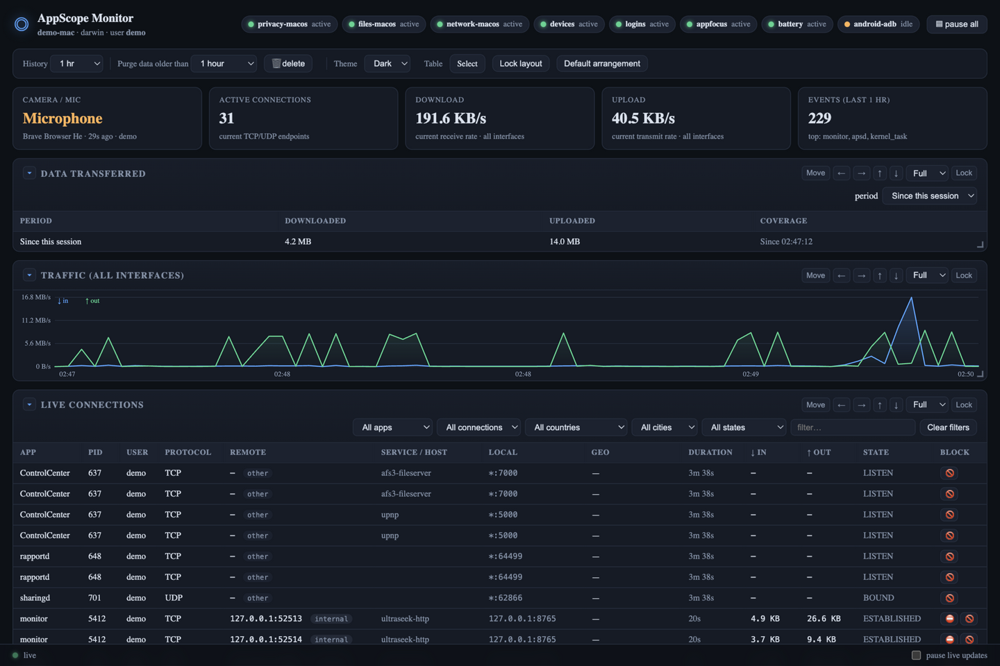
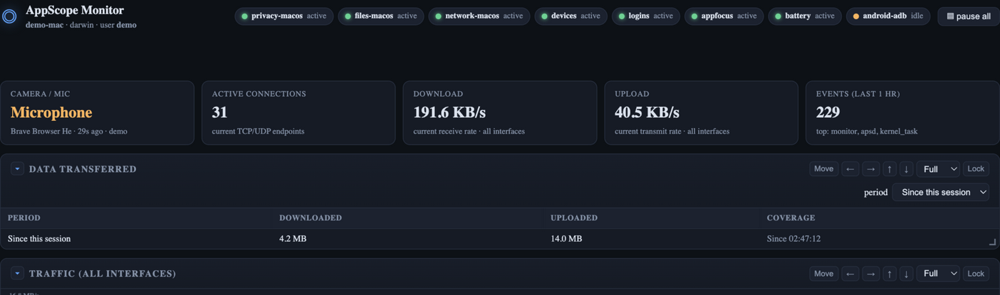
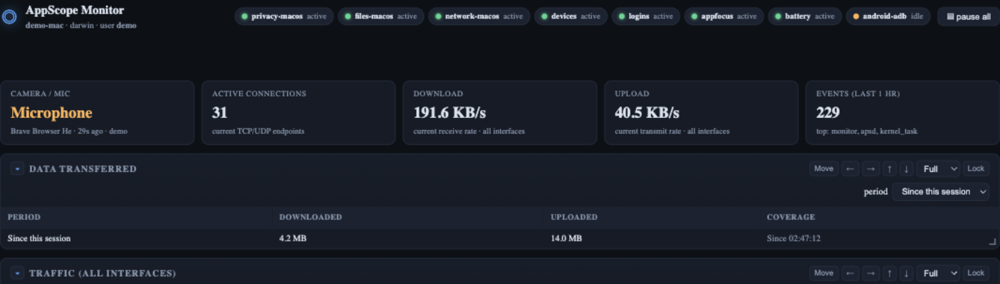
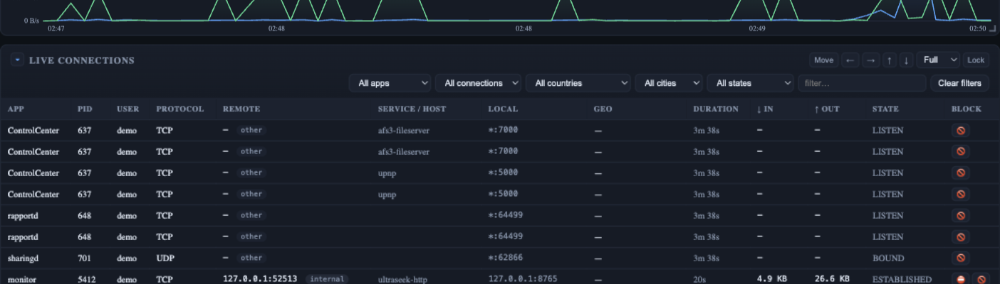

# 🛡️ AppScope Monitor

**See what your computer is really doing — and cut off anything you don't like.**

AppScope Monitor is a live dashboard for your Mac, Windows PC, or Linux box that answers three
questions in real time: *who is using my camera and mic?*, *which apps are talking to the
internet (and where)?*, and *how do I block them?* — all on one page, all stored on your
machine, nothing sent anywhere.

| | |
|---|---|
|  |  |
|  |  |

*(Screenshots were taken on a demo machine — `demo-mac`, user `demo`. Example IPs use the
documentation ranges `203.0.113.x`.)*

---

## What you get

- **🎥 Privacy watch** — every camera, microphone, contacts, calendar and automation access
  request, with the exact app that made it. You see the honest TCC labels: *request*,
  *granted*, or *denied*.
- **🌐 Live connections** — every TCP/UDP endpoint on the machine: which app, which remote
  server, which country, how much data, live. Every row has a **block** button.
- **📁 File access** — which process opened which file in the folders you care about
  (on-demand on macOS, so it costs nothing until you ask for it).
- **⛔ Blocking that actually works** — block an IP, an IP+port, an app, an entire country,
  or your own blocklist file. Rules land in the OS firewall (pf / iptables / netsh).
- **🔋 The rest of the vitals** — battery, RAM, disk, top CPU processes, USB devices, logins,
  and (if you plug one in) an Android phone's camera/mic/network usage.

Everything runs **locally**: one small Go binary + a web dashboard on `127.0.0.1`. No account,
no cloud, no telemetry.

---

## Install

### The easy way — with the AppDeck launcher

1. Put this folder in the launcher's `Apps/` directory (or import its zip).
2. Start the launcher — it builds the app automatically on first start.
3. Click the **🛡️ AppScope Monitor** tile. Your browser opens the dashboard. Done.

### The standalone way — just Go

Requires [Go](https://go.dev/dl/) 1.27+. No C compiler, no extra installs — the whole thing
is pure Go.

```sh
cd AppScopeMonitor
go build -o monitor ./cmd/monitor   # builds the binary
./monitor --open                     # start it and open the dashboard
```

The dashboard lives at `http://127.0.0.1:8765` (change with `--port`).

---

## Your first five minutes

1. **Look at the top row.** Four cards: camera/mic status, active connections, live download
   and upload speed, and total events this hour. Below them, the traffic chart and the live
   connections table.
2. **Find a talker.** In *Live connections*, sort or filter by app. Every row shows where the
   connection goes (IP, host, country) and how long it's been alive.
3. **Block something.** Click the 🚫/**⛔** button on any row (or use the form on the
   *Blocked connections* panel — try `203.0.113.10`, a safe test address). The rule appears
   instantly with status **queued**.
4. **Make it real — the one-time Grant.** Queued rules are stored but not enforced, because
   changing the firewall needs permission the monitor doesn't have. Click **grant** on the
   Blocked panel; your OS asks for your password **once** (UAC on Windows, polkit on Linux,
   password sheet on macOS) and every queued rule goes live. The monitor itself never runs
   with elevated rights — see [Safety](#safety--the-one-time-grant) if you want the details.
5. **Make it yours.** Pick a theme (Dark / Blue / Light / Red), drag panels around, resize
   them, hide the ones you don't care about. Your layout is remembered.

---

## Everything it can do

| Area | Features |
|---|---|
| **Watch** | Live connection table (app, PID, user, protocol, host, geo, per-connection block) · per-app and per-site traffic · connections by country/city · data-transfer totals per period · connection history (persisted, filterable) |
| **Privacy** | Camera / mic / contacts / calendar / automation (AppleScript) events on macOS (TCC) and Windows (ConsentStore) · per-app file-open tracing · on-demand root file tracing with a padlock toggle |
| **Block** | Rule types: `ip`, `ip:port`, app (path), country (all its IPv4 ranges), blocklist file, pasted IP list, IPolice-managed lists · one-click re-apply · per-country ⛔ from the geo table |
| **Vitals** | Battery + power estimates, RAM, disks/volumes, top CPU processes, USB/device connect events, login sessions, focused app |
| **Dashboard** | Live updates over SSE · 4 themes · drag / resize / hide / lock any panel · persisted layout · history purge tools |
| **Data** | Everything stored in a local SQLite file (`data/`) — inspect or delete it any time; the 🗑 button purges old events |

---

## How it's built (for the curious / the expert)

```
┌────────────────────────────── collectors (per platform) ──────────────────────────────┐
│  privacy (TCC/ConsentStore)   files (fs_usage/auditd/FSW)   network (lsof/ss/netsh)  │
│  battery · devices · logins · appfocus · android (adb)          build-tag selected    │
└──────────────┬─────────────────────────────────────────────────┬──────────────────────┘
               │ events                                          │ snapshots
               ▼                                                 ▼
        ┌────────────┐   ┌──────────┐   ┌──────────────────────────────┐
        │  store.go  │◄──│ context  │──►│ netstate (conns, traffic)    │
        │ SQLite+SSE │   │  Ctx     │   └──────────────────────────────┘
        └─────┬──────┘   └────┬─────┘
              │ events         │
              ▼                ▼
        ┌────────────────────────────┐      ┌─────────────────────────────────────┐
        │ server.go — HTTP + SSE on  │      │ enforcer — pf / iptables / netsh    │
        │ 127.0.0.1, embedded web UI │      │ + one-shot privileged grant helpers │
        └────────────────────────────┘      └─────────────────────────────────────┘
```

- **One Go module, two dependencies**: `modernc.org/sqlite` (pure-Go SQLite, no cgo) and
  `golang.org/x/sys`. Cross-compiles everywhere.
- **Platform matrix** — the three platform collectors are native on Windows, macOS and Linux:

  | OS | amd64 | arm64 | 386 | armv7 | notes |
  |---|:---:|:---:|:---:|:---:|---|
  | Windows (primary) | ✔ | ✔ | ✔ | – | enforcer via netsh + `AppScopeBlock` broker task |
  | Linux | ✔ | ✔ | ✔ | ✔ | iptables direct (root) or via sudo helper |
  | macOS | ✔ | ✔ | – | – | pf anchor + app firewall via helper |
  | FreeBSD/OpenBSD/NetBSD | ✔ | – | – | – | portable collectors only; blocking queues |

- **Repo layout**: `*.go` at root (context, config, store, server, netstate, geo, enforcer,
  grant, themes) · `collectors/` (build-tagged per OS) · `web/` (dashboard, embedded in the
  binary) · `cmd/monitor/` (CLI entrypoint) · `scripts/` (grant/revoke helpers, embedded and
  materialized at start) · `docs/screenshots/`.
- **CLI flags**: `--config` · `--host` · `--port` · `--open` · `--debug`.
- **Country blocking** uses per-country CIDR ranges (IPv4). With the companion **IPolice**
  app running, ranges are fetched over loopback and cached in `data/country-cidrs/`; without
  it, country rules simply stay queued. The monitor itself makes no blocklist downloads.
- **External network calls (all optional, cached)**: geo enrichment via ip-api.com and a
  one-shot own-country lookup for the guardrail below. That's it.

### Safety — the one-time grant

The monitor never runs elevated. When you click **grant**, a *drop-only* helper is installed
through your OS's own password dialog, and it can do exactly one thing: add or remove BLOCK
rules.

- Arguments are strictly validated (IPv4 parse, port range, absolute paths) — in the monitor
  *and again inside the helper*.
- Loopback, RFC1918, CGNAT, link-local and multicast ranges are filtered before anything
  reaches the firewall, so the dashboard and your LAN can never be caught by a block. Blocking
  your own country requires an explicit extra confirmation.
- The grant API is loopback-only — a phone on your Wi-Fi can't trigger password dialogs.
- Click the padlock on the Blocked panel to revoke: helper, its passwordless entry, and all
  applied rules are removed; stored rules return to queued.

---

## Troubleshooting

| Symptom | Fix |
|---|---|
| Panel says `fs_usage exits immediately` | Another tracer holds the kernel stream: `sudo pkill -9 -x fs_usage`, then click the chip again. |
| Rules stuck on `queued` | Expected until you grant once. Click **grant** on the Blocked panel. |
| `port already in use` | Another instance is running, or pass `--port <other>`. |
| File panel empty on Linux | Full per-syscall attribution needs root + auditd; the no-root `/proc` mode only sees files held open between polls. |

## Building & testing

```sh
gofmt -l .          # should print nothing
go vet ./...
go test ./...
go build ./...      # host platform
./build.sh          # full cross-platform matrix into dist/
```

---

*Categories of data this app touches: process list, network endpoints, TCC/privacy logs, file
open events in watched folders. All of it stays in `data/` on your machine.*
