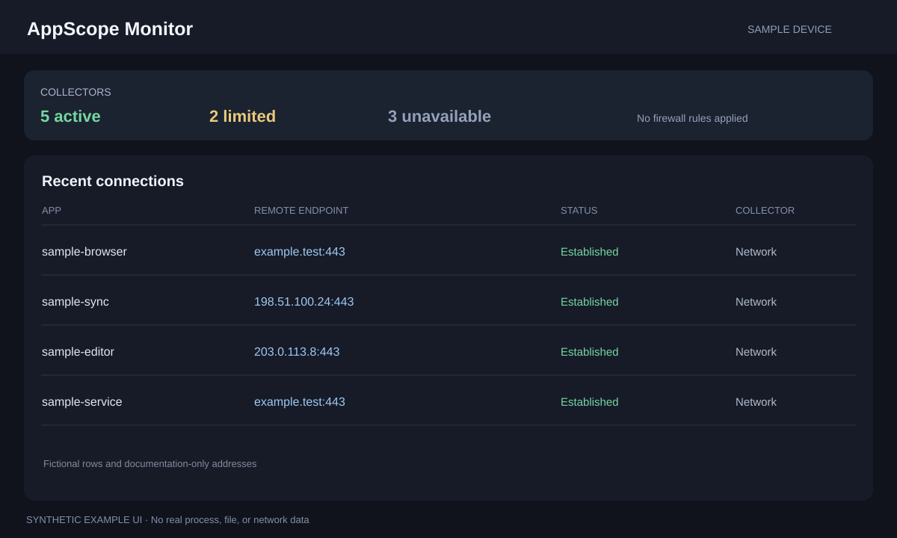

# AppScope Monitor

AppScope Monitor is a local dashboard for device, privacy, file, and network
activity. It is most useful on the computer being monitored. It does not send
your event database to a remote service.



*Privacy-safe UI preview: synthetic sample events only. It does not show a
real device, process list, address, or user.*

## Run with AppDeck

1. Install Go 1.27 or newer.
2. Start AppDeck from its folder with `go run .`.
3. In the AppDeck dashboard, select **Start** on **AppScope Monitor**, then
   select **Open**.

AppDeck builds the Go app the first time it starts. Leave AppDeck running
while you use the dashboard. Stop the app from its card when you are done.

## Run directly

From this folder:

```sh
go run ./cmd/monitor --host 127.0.0.1 --port 8765 --open
```

Open <http://127.0.0.1:8765> if it does not open automatically. Press
**Ctrl+C** in the terminal to stop it. To build a local executable instead:

```sh
go build -o monitor ./cmd/monitor
./monitor --host 127.0.0.1 --port 8765
```

On Windows, name the output `monitor.exe` and run `.\monitor.exe` in
PowerShell.

## What to expect

The dashboard reports which collectors are active, unavailable, or running
with reduced coverage on your operating system. Available sections can
include network connections, privacy events, file activity, devices,
processes, and system vitals. Some operating systems require additional
permissions for particular collectors; the dashboard reports their status.

The default dashboard binding is local-only. Firewall blocking and macOS
file tracing are separate, explicit actions that may request operating-system
authorization. Review the action and its scope before approving a prompt.
The app itself should not be run as administrator/root for normal monitoring.

## Data and configuration

When AppDeck starts the app, its files are kept in the app's private
`APPDECK_DATA` directory. A direct run uses the app's normal local config and
data defaults. Do not share its database or exported events without reviewing
them: they can contain process names, file paths, network addresses, and
privacy-event details.
