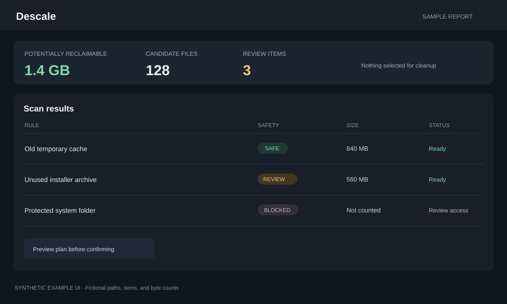

# Descale

Descale reports cleanup candidates, installed-app leftovers, and startup
items. Review its report before choosing anything to clean. Confirmed cleanup
normally moves selected files to Trash so they can be restored; it does not
automatically clean your computer.



*Privacy-safe UI preview: fictional file names and sizes; no personal paths
or scan results are included.*

## Run with AppDeck

1. Install Go 1.27 or newer.
2. Start AppDeck from its folder with `go run .`.
3. Select **Start** on **Descale**, then **Open**.

AppDeck builds the app the first time it starts. Descale binds to the local
computer because it can move files to Trash. Do not change its network
binding or expose it to other devices.

## Run directly

From this folder, start the dashboard with:

```sh
go run . serve 8212
```

Open <http://127.0.0.1:8212>. Press **Ctrl+C** to stop it. The command-line
report is also available:

```sh
go run . scan
```

`scan` only reports results; it does not clean files. To build a reusable
executable, run `go build -o descale .` and then `./descale serve 8212`.
On Windows, use `go build -o descale.exe .` and run
`.\descale.exe serve 8212`.

## Use it carefully

1. Choose **Scan** and wait for the report to finish.
2. Read each rule's status, safety label, and sample list. An unavailable or
   blocked rule is not evidence that its target is empty.
3. Leave review-only items unchecked unless you know what they are.
4. Review the proposed plan before confirming a cleanup.
5. Use the journal/restore view if you need to put a moved item back.

Do not run Descale as administrator/root just to get a larger result. Some
operating-system-protected folders may be unavailable; the app should report
that rather than encouraging a blind cleanup.

Descale's AppDeck data directory contains its cleanup journal. Direct runs
use local application defaults. Scan results can reveal usernames, file
names, and paths, so review exports and screenshots before sharing them.
