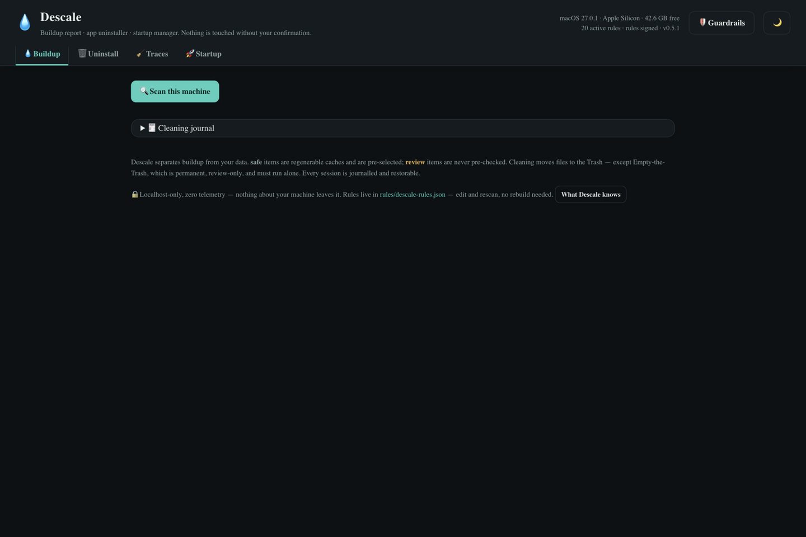
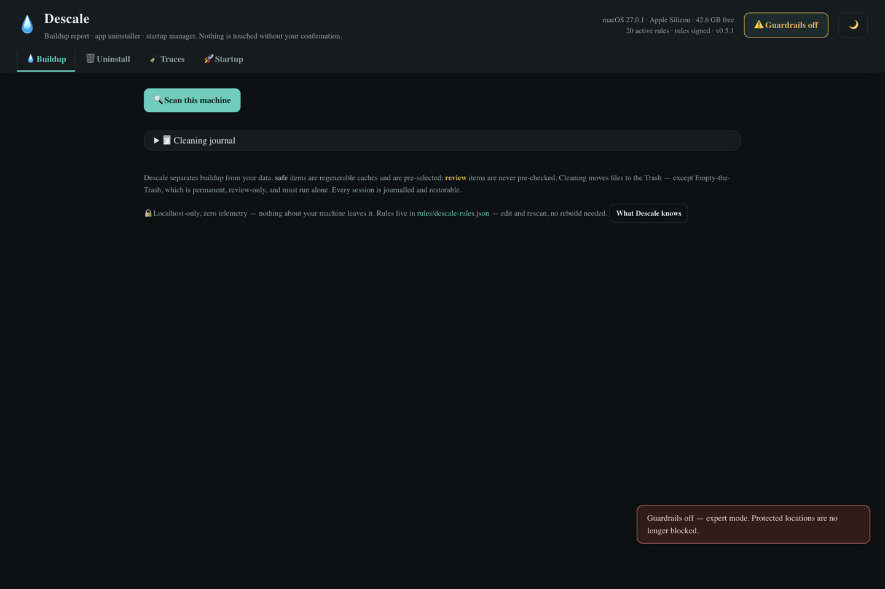
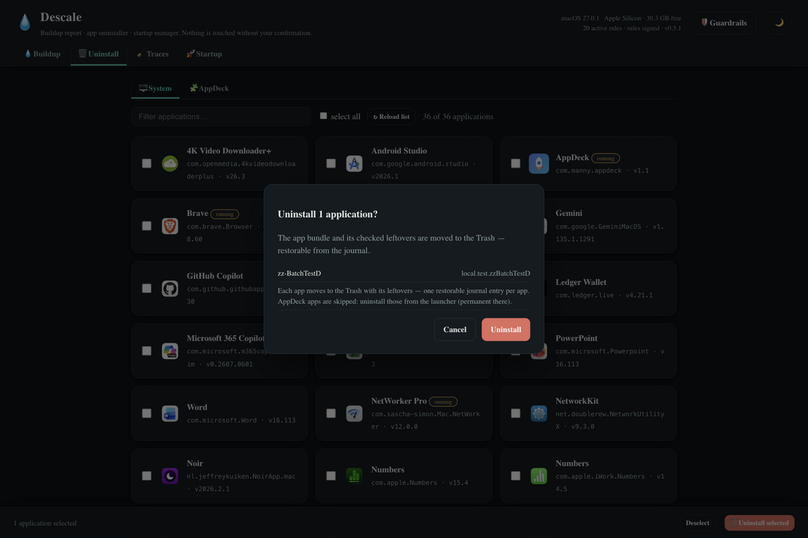

# 💧 Descale

**The kettle-cleaner for your computer: buildup report, app uninstaller and startup
manager — and nothing is ever touched without your confirmation.**

Caches, logs, crash reports, leftover app traces, things that sneak into login items…
Descale finds the scale, shows you exactly what it is, and moves it to the Trash (never
straight to deletion). Every session is journalled and restorable.

| | |
|---|---|
|  |  |
|  | |

---

## What you get

- **💧 Buildup report** — regenerable caches (browser, app, cargo, brew…), logs, crash
  reports, orphaned downloads — grouped, sized, and separated from *your data*.
- **🗑️ App uninstaller — one app or a whole batch** — pick an app (or check
  several and press *Uninstall selected*): Descale collects the binary plus its scattered
  traces (preferences, appdata, caches) for one confirmed Trash move. Batch
  uninstalls write one restorable journal entry per app; running apps and
  AppDeck apps (their removal is permanent) are skipped with a reason —
  uninstall AppDeck apps from the launcher's own batch select.
- **🧹 Traces** — leftovers from apps already gone.
- **🚀 Startup manager** — see and toggle what launches at login.
- **🧾 Cleaning journal** — every session recorded, with what went where, so a clean is
  always reviewable and restorable.
- **🛡️ Guardrails, by design**:
  - *safe* items (regenerable caches) are pre-selected; *review* items are never
    pre-checked — you opt in, one by one.
  - Cleaning moves files **to the Trash**; "Empty the Trash" is the only permanent action,
    review-only, and must run alone.
  - Rules are **signed** — the engine refuses rule files that don't match their signature.
  - Localhost-only, zero telemetry: nothing about your machine leaves it.
- **📐 OS/arch-aware** — macOS-first (Trash semantics, Apple Silicon), with platform-aware
  rule sets.

---

## Install

### The easy way — with the AppDeck launcher

1. Put this folder in the launcher's `Apps/` directory (or import its zip).
2. Start the launcher — it builds Descale on first start — and click the **💧 Descale** tile.

### Build it yourself

Requires [Go](https://go.dev/dl/):

```sh
cd Descale
go build -o descale ./cmd/descale
./descale 8212
# open http://127.0.0.1:8212
```

(`start.sh` / `start.bat` at the root do the same.)

---

## Your first five minutes

1. Read the landing page — the guardrails summary tells you the rules of the game before
   anything happens. The server starts **read-only** until you confirm a clean.
2. Press **🔍 Scan this machine** — you'll get a buildup report grouped by category with
   sizes.
3. Review the pre-checked *safe* items (caches that regenerate); anything marked *review*
   starts unchecked — read before ticking.
4. **Clean** — items go to the Trash. Changed your mind? The **🧾 journal** shows the
   session and restores it.
5. Visit **🚀 Startup** to trim what auto-launches, and **🗑️ Uninstall** the apps you
   thought you'd removed.

---

## How it's built (for the curious / the expert)

```
cmd/descale/          — Go server: scan engine, Trash-based removal, journal, signature check
rules/descale-rules.json (+ .sig) — cleanup rule definitions: DATA, not code —
                        edit the JSON and rescan, no rebuild needed; the .sig pins the
                        ruleset so a swapped file is rejected
index.html, js/app.js, css/app.css — dashboard UI served by the binary
start.sh / start.bat  — manual launch helpers
```

- **Rules as data** — one JSON describes per-OS targets (app-caches, browser-caches,
  app-logs, crash-reports, cargo/brew caches…), their safety class, and the action to take.
- **Confirm-first architecture** — the server boots read-only; every mutation requires an
  explicit confirmation flow, and everything lands in the Trash except the single,
  review-only "Empty the Trash".
- Runs loopback-only; the UI is the only client.

## Verify

```sh
go build ./...         # then run the binary and open the dashboard
```
