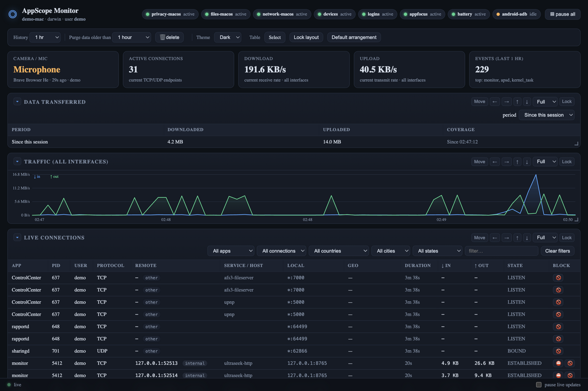
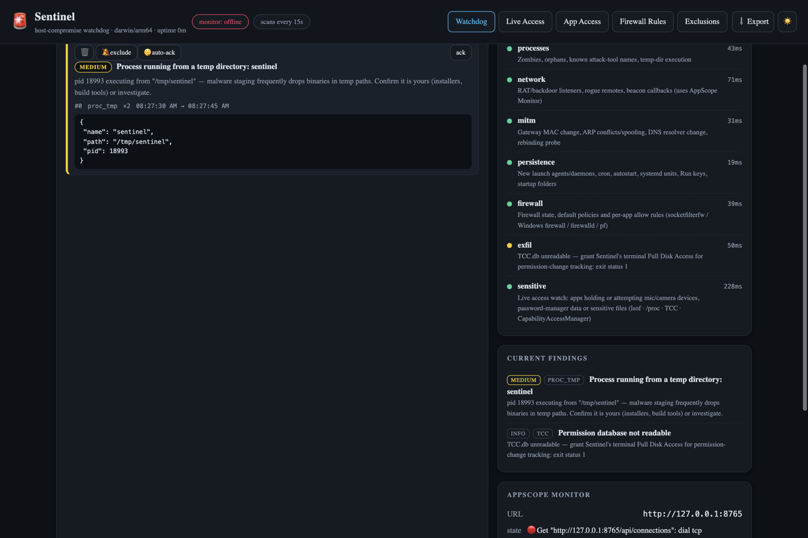
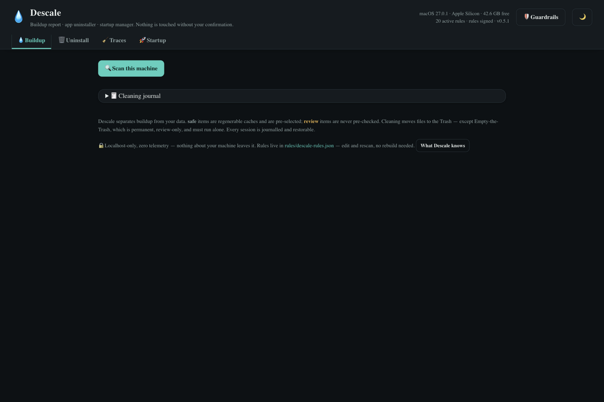
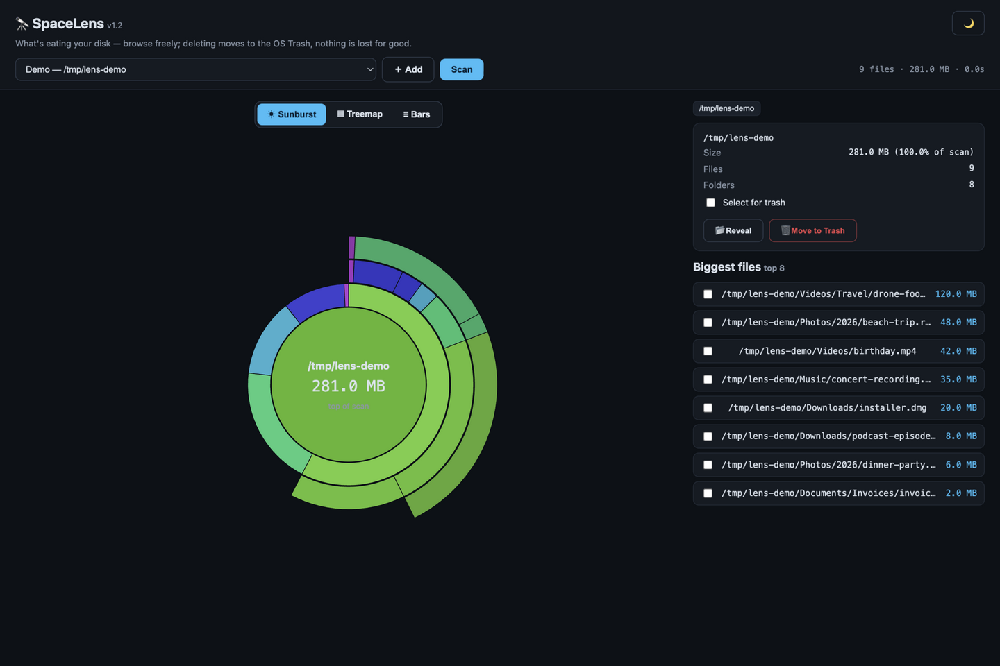
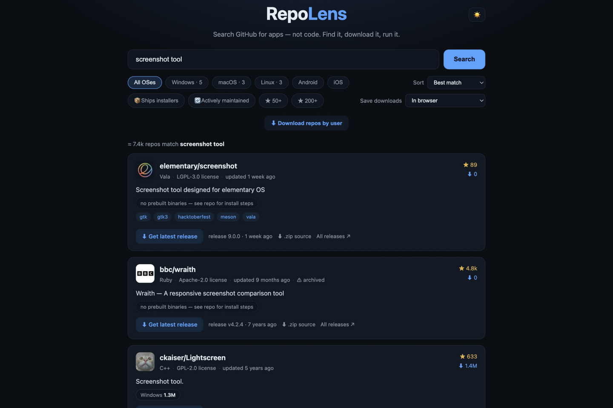
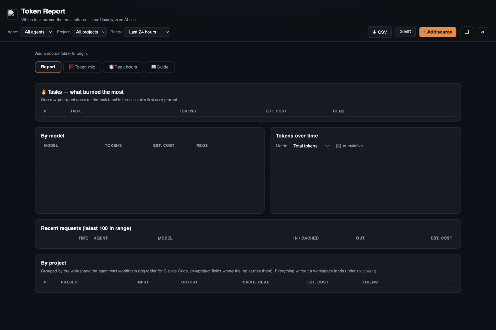
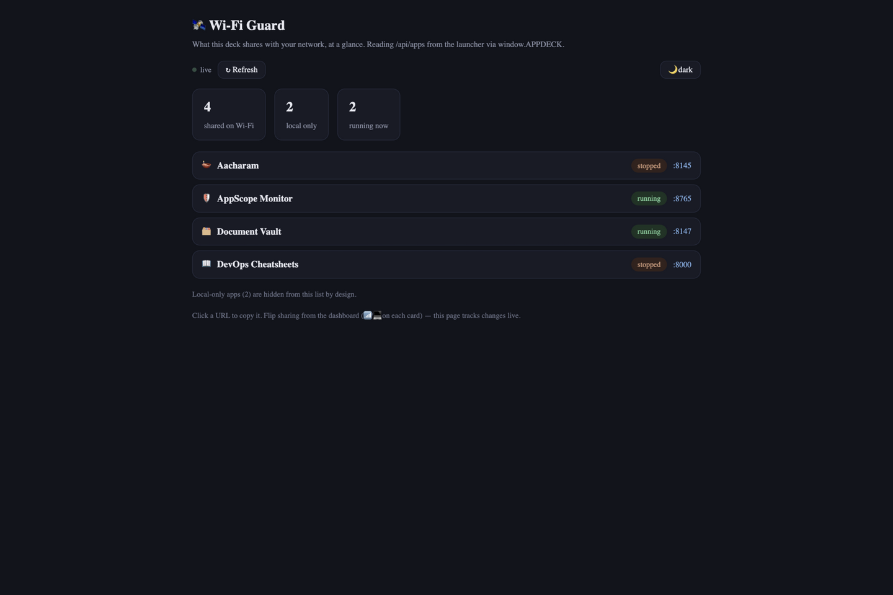

# AppDeck apps

This repository is the **deck**: the app collection AppDeck loads. Every
folder here is one app that the
[AppDeck launcher](https://github.com/4ppd3ck/Appdeck) discovers and runs —
start AppDeck from its own folder next to this one and every app below
appears on its dashboard.

For a first run, keep `Apps/` beside the `Appdeck/` launcher folder, then
start AppDeck with `go run .` from inside `Appdeck/`.

## The apps

| App folder | Purpose | How to run |
|---|---|---|
| [AppScopeMonitor](AppScopeMonitor/README.md) | Local device, privacy, and network activity dashboard | Start from AppDeck; Go can also run it directly |
| [Sentinel](Sentinel/README.md) | Host checks and security alerts | Start from AppDeck; Go can also run it directly |
| [Descale](Descale/README.md) | Review cleanup candidates and restore items from Trash | Start from AppDeck; Go can also run it directly |
| [SpaceLens](SpaceLens/README.md) | See what's eating your disk — sunburst, treemap and bars — then send the hogs to Trash | Start from AppDeck; Go can also run it directly |
| [RepoLens](RepoLens/README.md) | Search GitHub for open-source applications | Start from AppDeck or run the Go server directly |
| [TokenReport](TokenReport/README.md) | Analyze selected local AI-agent logs | Start from AppDeck |
| [WifiGuard](WifiGuard/README.md) | View which AppDeck apps are shared on Wi-Fi | Start from AppDeck |

AppScopeMonitor, Sentinel, Descale, SpaceLens and RepoLens are Go apps the
launcher builds on first start; TokenReport and Wi-Fi Guard are static pages
served by AppDeck itself, with no separate runtime.

## Screenshots

*All screenshots show synthetic, privacy-safe example data — no real
workstation, network, or file details.*

| | |
|---|---|
| <br>**AppScope Monitor** — device, privacy and network activity | <br>**Sentinel** — host checks and alerts |
| <br>**Descale** — cleanup candidates | <br>**SpaceLens** — sunburst disk map |
| <br>**RepoLens** — GitHub app search | <br>**Token Report** — AI-agent log analysis |
| <br>**Wi-Fi Guard** — apps shared on Wi-Fi | |

More views are in each app's `docs/screenshots/` folder — Sentinel's alert
feed, Descale's guardrails and batch uninstall, SpaceLens's treemap,
RepoLens's search page, and AppScope Monitor's privacy, files and
blocked-connections screens.

## Get AppDeck from the releases

The launcher lives in its own repository —
[4ppd3ck/Appdeck](https://github.com/4ppd3ck/Appdeck) — and its
[releases page](https://github.com/4ppd3ck/Appdeck/releases) ships zipped
binaries for Windows, macOS, and Linux in two flavors:

- **AppDeck** (`v…` releases) — the launcher on its own. It discovers and
  starts apps from this folder, so use it alongside a checkout of `Apps/`.
- **All in one** (`aio-v…` releases) — a single AppDeck executable with all
  the apps in this repository already packed inside it. No Go toolchain and
  no source checkout needed: download the zip for your platform, unzip, and
  run.

Both flavors include per-platform zips plus a `SHA256SUMS` file; the
All-in-One builds are the ones to hand to someone who just wants the deck
working.

## First-time setup

1. Install Go 1.27 or newer if you plan to run AppDeck or build a Go app.
2. Start the launcher from `Appdeck/`:

   ```sh
   go run .
   ```

3. Open <http://127.0.0.1:9090> if the browser did not open automatically.
4. On an app card, choose **Start**, then **Open**.
5. To shut down, stop the app from its card, then press **Ctrl+C** in the
   terminal running AppDeck.

The launcher builds Go apps the first time they are started, so a working
internet connection may be needed to download Go modules.

## Importing more apps

The dashboard's **📥 Import** button adds new apps to this folder. One
dialog takes every source type:

| Source | Notes |
|---|---|
| Archive — zip, tar.gz, tar, rar | Must carry `app.json` at its root (one wrapping folder is stripped); a `.rar` is read with the machine's bsdtar, 7-Zip or unrar |
| macOS `.dmg` | macOS only: the `.app` bundle is imported whole, signature included |
| Portable binary (`.exe`, AppImage, …) | Wrapped in place and never executed at import time; the launcher sniffs whether it serves a web page or is a desktop app |
| Single `.html` file | Becomes a static app hosted by the launcher |
| Git repository URL | Shallow-cloned; a missing `app.json` and icon are generated from the repo layout. `…/tree/main/Folder` imports one folder out of a monorepo |
| Any other URL | Downloaded (512 MB cap) and routed by content type |
| Local folder path | Must carry a valid `app.json`; copied into the deck |

Good to know:

- Every import lands in `Apps/<id>/` and is validated — a failed import
  leaves nothing behind.
- App ids are unique: remove the old folder before importing an app with
  the same id again.
- The import log is live in the dashboard dock during the import and
  persisted to `logs/imports.log` afterwards; a stuck import can be
  aborted with the dock's **■ Cancel** button.
- To write your own app instead of importing one, see the launcher's
  [AUTHORING.md](https://github.com/4ppd3ck/Appdeck/blob/main/AUTHORING.md)
  — `appdeck new "My App"` scaffolds a working app into this folder.

## Keep your data private

Some apps collect local system information, scan local files, or read log
folders you select. Read the app-specific privacy notes before using them.
Do not publish logs, screenshots, exports, or runtime data without checking
them for usernames, device names, file paths, IP addresses, tokens, and other
private details.

AppDeck can make some apps reachable by other devices on your Wi-Fi. Keep
sharing disabled unless you need it. None of these apps should be exposed
directly to the public internet.
