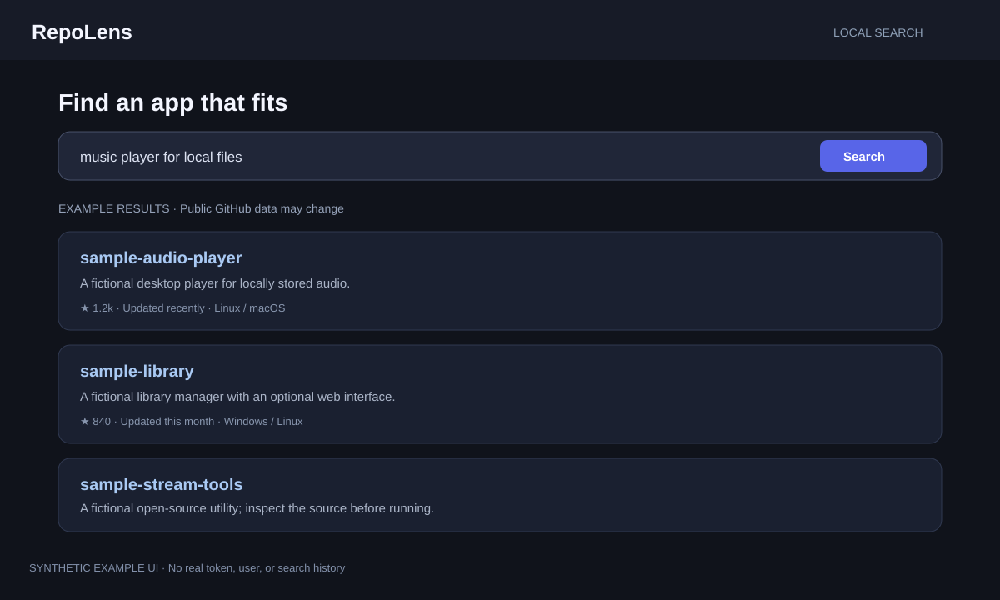

# RepoLens

RepoLens searches GitHub for open-source applications and helps you find
their release downloads or source archives. It runs a small local web server;
searching uses GitHub's public API.



*Privacy-safe UI preview: synthetic search text and example results only.*

## Requirements

- Go 1.26 or newer (the module declares Go 1.26).
- Internet access for GitHub searches and downloads.
- A GitHub token is optional. Without one, GitHub applies its lower
  unauthenticated API limits.

## Run with AppDeck

Start AppDeck from its folder with `go run .`, then start **RepoLens** and
open its app card. AppDeck builds the app the first time if needed.

## Run directly

From this folder:

```sh
go run ./cmd/repolens 3000
```

Open <http://127.0.0.1:3000>. Press **Ctrl+C** in the terminal to stop the
server. The server listens on loopback by default.

## Optional GitHub token

You can use RepoLens without a token. If you choose to provide a token, use a
personal token with only the permissions you need; public repository search
does not require repository write access. Set `GITHUB_TOKEN` or `GH_TOKEN`
in your terminal environment rather than pasting a real token into this
README, screenshots, or a tracked file. The app also reads a local `.env`
file, which is ignored by Git; never commit that file.

RepoLens stores search/cache data locally in `data/` for a direct run, or in
AppDeck's app-specific data folder when launched by AppDeck. Review files
before sharing them. Repository names and descriptions are supplied by
GitHub; verify a project's source and release before running downloaded
software.
