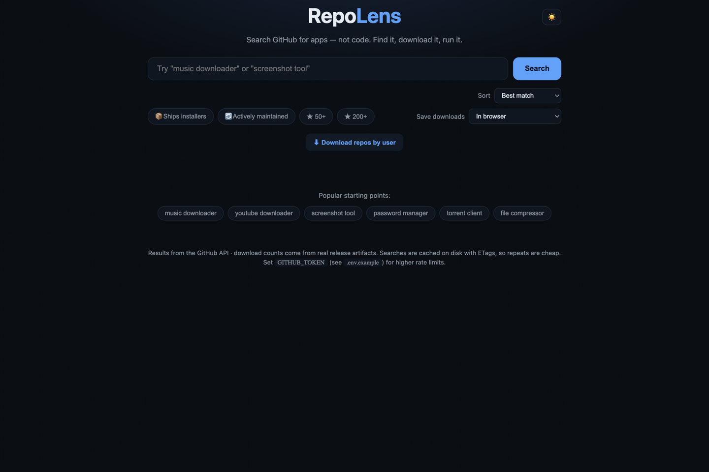
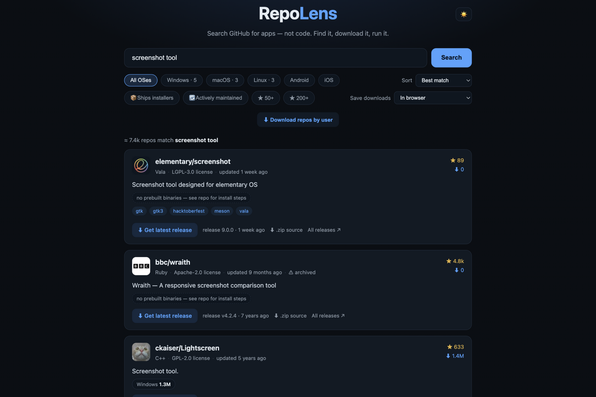

# 🔎 RepoLens

**Search GitHub for *apps*, not code — find a tool, see its real download counts, grab the
installer, run it.**

GitHub search finds repositories; RepoLens finds *runnable software*: it scans releases
for actual installers and artifacts (exe, dmg, apk, deb…), counts real downloads from
release data, filters by OS and maintenance, and downloads what you pick — one repo, or a
whole user's repos at once.

| | |
|---|---|
|  |  |

---

## What you get

- **🎯 App-oriented search** — "screenshot tool", "password manager", "torrent client"…
  with popular starting points one click away.
- **📊 Real numbers** — downloads counted from actual release artifacts (not stars-as-
  proxy); sort by best match, most downloads, most stars, most active.
- **🖥️ OS facets** — Windows/macOS/Linux/Android/iOS counts computed from the artifacts
  themselves, plus 📦 *ships installers* and 🔄 *actively maintained* filters and ★
  thresholds.
- **⬇️ Download smartly** — save in-browser, to a folder you choose, or Ask-every-time;
  **download repos by user** mirrors a whole account's releases.
- **🧩 Install on AppDeck** — when RepoLens runs under the [AppDeck](../../Appdeck) launcher,
  every result card gets an install button: the best release for your OS is handed to the
  dashboard's import (or the repo source is git-imported and a manifest generated), with
  live progress, a ✓ badge on already-installed repos and an **Update** label for
  reinstalls. The bulk panel can install a whole user's repos the same way. Run standalone,
  the button simply doesn't appear.
- **⚡ Cheap repeats** — searches cached on disk with ETags; set `GITHUB_TOKEN` (see
  `.env.example`) for higher rate limits.

---

## Install

### The easy way — with the AppDeck launcher

1. Put this folder in the launcher's `Apps/` directory (or import its zip).
2. Start the launcher — it builds RepoLens on first start — and click the **🔎 RepoLens**
   tile.

### Build it yourself

Requires [Go](https://go.dev/dl/):

```sh
cd RepoLens
go build -o repolens ./cmd/repolens
./repolens -port 8775
# open http://127.0.0.1:8775
```

Optional: copy `.env.example` and set `GITHUB_TOKEN` for higher API rate limits.

---

## Your first five minutes

1. Click a *popular starting point* (or type your own) — results arrive with OS facets.
2. Filter to your OS and tick 📦 *Ships installers*.
3. Sort by **Most downloads** — the numbers come from real release artifacts.
4. Pick a repo; choose where downloads go; grab the installer.

---

## How it's built (for the curious / the expert)

```
cmd/repolens/ — Go server: GitHub search + releases API client, artifact scanning,
                download plumbing, ETag-cached responses on disk, AppDeck install bridge
public/       — static frontend (index.html, app.js, styles.css) served by the binary
```

- The interesting logic is release-artifact classification: platform detection from
  filenames, installer vs source archive, and download-count aggregation.
- The server is the only networked piece (GitHub API + artifact downloads); the UI talks
  to it on loopback.
- The AppDeck bridge (`appdeck.go`) is what makes **Install on AppDeck** work: a page
  inside AppDeck can't reach the dashboard's `POST /api/import` cross-origin, so the
  server — a loopback client of the launcher via `APPDECK_LAUNCHER_URL` — proxies the
  install and relays the launcher's import progress.

## Verify

```sh
go build ./... && go vet ./...
./repolens -port 8775   # run a search, check facets and counts
```
