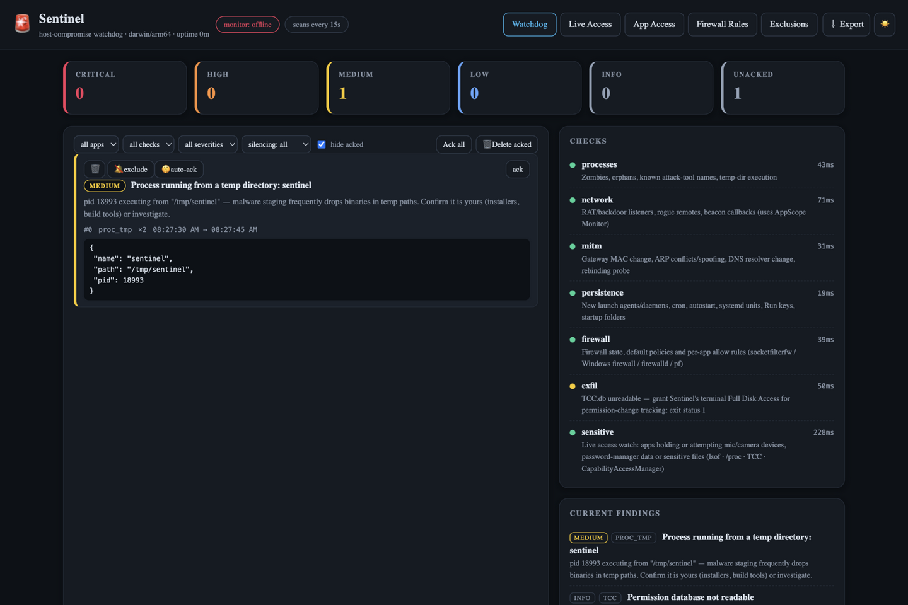
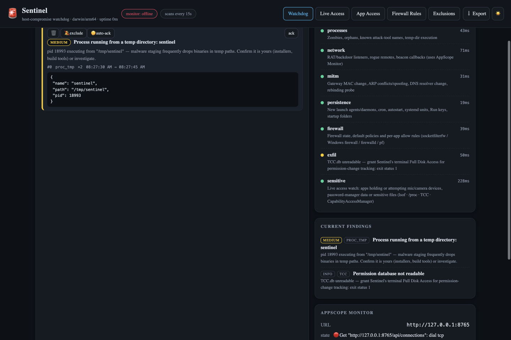

# 🚨 Sentinel

**A host-compromise watchdog for your machine — RATs, MITM, rogue IPs, zombie processes,
keyloggers, exfiltration: checked every 15 seconds, alerted the moment they appear.**

Sentinel never talks to the internet. It watches *your own machine* — processes, network
listeners, ARP/DNS state, persistence locations, the firewall — and enriches network
findings with provider intelligence from **IPolice** (its loopback-only partner) and
connection data from **AppScope Monitor** when that's running. Detection rules, not vibes:
every alert names the check, the evidence, and what to do.

| | |
|---|---|
|  |  |

*(Screenshot: a real catch — the watchdog flagged a binary running from a temp directory,
exactly the way malware stages itself.)*

---

## What you get

- **🧟 Process checks** — zombies, orphans, known attack-tool names, execution from temp
  paths.
- ** RAT/backdoor listeners, rogue remotes, beacon-callback patterns** — enriched with
  AppScope Monitor's connection stream when available.
- **🕵️ MITM checks** — gateway MAC changes, ARP conflicts/spoofing, DNS resolver changes,
  rebinding probes.
- **⚓ Persistence checks** — new launch agents/daemons, cron, autostart, systemd units,
  Run keys, startup folders.
- **🧱 Firewall checks** — firewall state, default policies, per-app allow rules.
- **🚨 A working alert pipeline** — severities CRITICAL→INFO, ack/exclude/auto-ack per
  finding, silencing windows, notifications, export; scans every 15 s.
- **🔒 Architecture honesty** — Sentinel makes **zero external requests**; the *only*
  internet-facing half of the pair is IPolice (see its README), and they talk over
  loopback.

---

## Install

### The easy way — with the AppDeck launcher

1. Put this folder in the launcher's `Apps/` directory (or import its zip).
2. Start the launcher — it builds Sentinel on first start — and click the **🚨 Sentinel**
   tile. Run it beside **AppScope Monitor** and **IPolice** for the full picture.

### Build it yourself

Requires [Go](https://go.dev/dl/):

```sh
cd Sentinel
go build -o sentinel ./cmd/sentinel
./sentinel                      # or: ./sentinel -once   (one scan, print, exit)
```

---

## Your first five minutes

1. Open the **Watchdog** tab — severity counts up top; unacked findings below with
   evidence JSON.
2. Read an alert fully: check name, the plain-language explanation, the evidence payload.
3. Real alert → investigate; known-benign → **ack** once, **exclude** the rule, or
   **auto-ack** its future occurrences.
4. Scan the **CHECKS** list — each shows what it looks for and how long it took.
5. Try **⇨ Export** to keep an incident record.

---

## How it's built (for the curious / the expert)

```
cmd/sentinel/
├─ engine.go / beacon.go / exfil.go / integ.go — the detection engine: process, network,
│   beacon-periodicity, exfil-heuristics and integrity checks
├─ firewall.go / intel.go — firewall state; provider intelligence via loopback IPolice
├─ alert.go / exclusions.go — severity pipeline, ack/exclude/auto-ack persistence
└─ main.go — loopback server + UI
Scripts/tcc.sh — macOS TCC helper
```

- **No-agent-hub design**: the watchdog reads only local state (+ the loopback feeds);
  there is no code path to an external network destination.
- `-once` mode makes the whole engine scriptable (cron it, pipe to your alerting).

## Verify

```sh
go build ./... && go vet ./... && go test ./...
./sentinel -once
```
