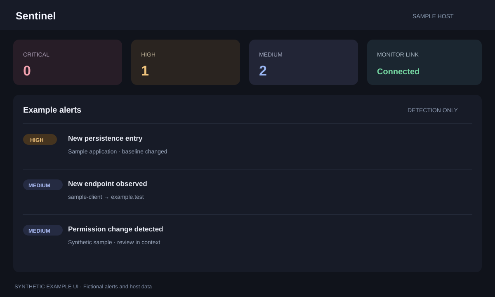

# Sentinel

Sentinel checks the local computer for security indicators and presents
alerts in a dashboard. It can also use AppScope Monitor's connection and
privacy events for additional context. Sentinel detects and reports; it does
not block network traffic.



*Privacy-safe UI preview: fictional alerts and device data only.*

## Run with AppDeck

1. Install Go 1.27 or newer.
2. Start AppDeck from its folder with `go run .`.
3. Start **AppScope Monitor** first if you want the extra event and
   connection context.
4. Start **Sentinel**, then choose **Open** on its card.

The first Go-app start can download dependencies and take a little time.
Sentinel continues its host checks if AppScope Monitor is unavailable, but
the dashboard will have less correlated information.

## Run directly

From this folder:

```sh
go run . --host 127.0.0.1 --port 8899
```

Open <http://127.0.0.1:8899>. Press **Ctrl+C** to stop it. To build a local
binary:

```sh
go build -o sentinel .
./sentinel --host 127.0.0.1 --port 8899
```

On Windows, use `go build -o sentinel.exe .` and run `.\sentinel.exe` in
PowerShell.

## First-run behavior and data

Sentinel learns a baseline of normal host and network information before
reporting many changes. Let it run long enough to establish that baseline,
then review alerts in context. A network, software, or permission change can
be expected and may still need review.

AppDeck stores Sentinel's state in its app-specific `APPDECK_DATA` folder.
A direct run defaults to `./data`. That state includes alerts and a baseline
of machine-specific details. Keep it local, and review it before sharing or
deleting it. Use **Reset baseline** in the dashboard only after an intentional
system or network change.

Sentinel can inspect local processes, network settings, persistence locations,
and platform permission records. Run it only on computers you own or are
authorized to administer. It does not replace antivirus or incident response.
