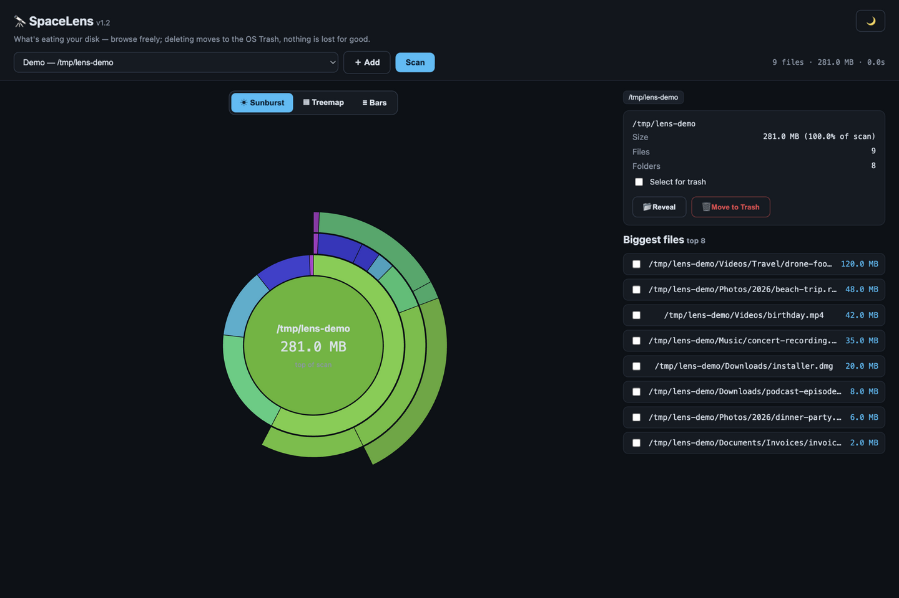
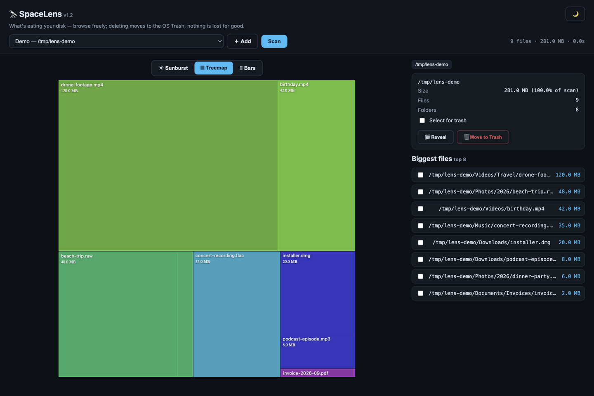

# 🔭 SpaceLens

**What's eating your disk? Scan any folder or volume and see it — sunburst, treemap or
bars — then drill in, reveal, and trash the hogs. Read-mostly by design.**

A DaisyDisk-style explorer with a concurrent Go scanner underneath: multi-root scans,
top-K biggest files ranked instantly, click-to-zoom navigation, and a deletion story you
can trust — **everything goes to the OS Trash**, never straight to deletion, and root
paths are guarded.

| | |
|---|---|
|  |  |

*(Screenshots: a fictional demo folder tree.)*

---

## What you get

- **☀️ Three views** — sunburst (click any segment to zoom, click the middle to go back
  up), treemap, and bars — all rendering the same live scan.
- **⚡ Concurrent scanning** — multi-root, multi-goroutine; a scan of thousands of files
  completes in moments, with a progress poll and cancel.
- **📋 Biggest files ranked** — top-K list with per-file checkboxes feeding the trash
  queue.
- **📂 Reveal** — open any file or folder in Finder / Explorer / your file manager.
- **🗑️ Safe deletion** — *Move to Trash only*; root paths and system locations are
  guarded; nothing is ever permanently deleted by SpaceLens.
- **📁 Native folder picker** — choose scan roots through the OS dialog; presets for home,
  Applications and volumes included.
- **🌙 Dark UI, fully local** — the scanner and server run on loopback.

---

## Install

### The easy way — with the AppDeck launcher

1. Put this folder in the launcher's `Apps/` directory (or import its zip).
2. Start the launcher — it builds SpaceLens on first start — and click the **🔭
   SpaceLens** tile.

### Build it yourself

Requires [Go](https://go.dev/dl/):

```sh
cd SpaceLens
go build -o spacelens ./cmd/spacelens
./spacelens -port 8767
# open http://127.0.0.1:8767
```

---

## Your first five minutes

1. Pick **Home** from the scan locations and press **Scan**.
2. Read the sunburst: the inner ring is your home folder, each spoke a child directory.
3. Click the biggest segment to zoom; click the middle to go back up.
4. Open **Biggest files**, tick the space hogs, **🗑 Move to Trash** (they go to the
   Trash — recoverable).
5. Switch between ☀ Sunburst / ▦ Treemap / ≡ Bars — pick the lens that fits the question.

---

## How it's built (for the curious / the expert)

```
cmd/spacelens/
├─ main.go      — flags/env/serve
├─ scanner.go   — concurrent multi-root tree scan, top-K biggest files
├─ server.go    — API (scan, poll, cancel, trash, reveal) + static
├─ hostguard.go — DNS-rebinding / cross-site guard (house style)
├─ reveal.go    — open in Finder/Explorer/xdg-open
├─ picker.go    — native OS folder chooser for scan roots
└─ trash.go     — move-to-trash with root-path guards
```

- **Read-mostly contract**: the only outward actions are reveal-in-file-manager and
  move-to-OS-Trash; `trash.go` refuses root/system paths outright.
- The scan API is poll-based, so big trees keep the UI responsive and cancellable.

## Verify

```sh
go build ./... && go vet ./...
./spacelens -port 8767   # scan a small folder, zoom, reveal
```
