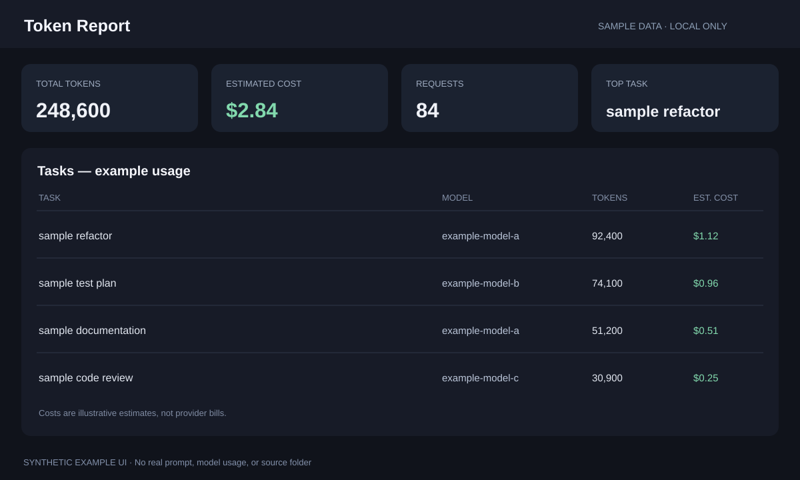

# Token Report

Token Report turns AI-agent usage logs into a local dashboard of tasks,
models, token counts, and estimated costs. Parsing happens in your browser.
It makes no AI calls and does not upload the folders you select.

*Privacy-safe UI preview: fictional task names and token counts only.*

## Run with AppDeck

Token Report is a static AppDeck app; it does not need Go, Node.js, or a
separate server.

1. Start AppDeck from its folder with `go run .`.
2. Find **Token Report**, select **Start**, then **Open**.
3. Select **Add source** and choose the folder containing the agent logs you
   want to analyze.

Your browser may ask permission to read the selected folder. Grant access only
to folders you intend to scan. The app keeps its browser-side source handles
and cached results locally; restore the access grant if your browser asks
after a restart.

## Sources and limits

Built-in source types include ZCode, Claude Code, Codex CLI, Copilot CLI,
OpenClaw/AutoClaw, and a generic JSON/JSONL parser. For an unsupported agent,
choose **Custom / new agent** and select its log folder.

The scanner skips common cache and dependency folders and has limits on the
number and total size of files. Some formats provide per-request counts;
others provide session totals only. Estimated costs use the editable price
table and are not a bill from the AI provider.

## Protect your data

Agent logs can contain prompts, source code, file paths, and other private
content. Choose a narrow source folder, do not include logs in public
screenshots or exports without checking them, and do not share the local
archive unless you have reviewed its contents.
