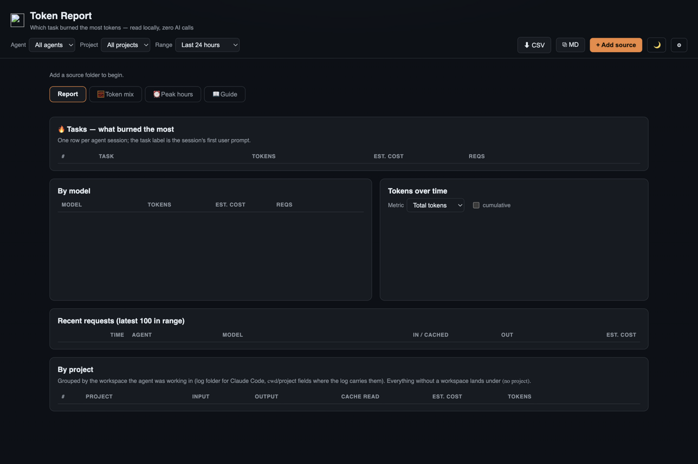

# 🔥 Token Report

**Which task burned the most tokens? — a local dashboard over your AI agents' logs: cost
estimates, token mix, peak hours, per-project totals. Zero AI calls; everything is read
from disk.**

Agents like Claude Code write structured session logs. Token Report scans those folders
locally, rebuilds every session, and answers the questions your bill raises: which task,
which model, which project, which hour — with per-request drill-down and budget deltas.



---

## What you get

- **🔥 Tasks ranked** — one row per agent session; the task label is the session's first
  user prompt. Tokens, estimated cost, request counts.
- **🧮 Token mix** — input / cached / output split per model, so you see what cache is
  actually saving you.
- **⏰ Peak hours** — when your agents work hardest, with cumulative or per-bucket views.
- **📁 By project** — grouped by the workspace each log carries (log folder for Claude
  Code, cwd/project fields elsewhere).
- **🔬 Recent requests** — the latest 100 in range, request by request.
- **🎚️ Filters** — agent, project, and time range (5 min → all time on disk, or custom).
- **⬇ CSV / ⧉ MD export** — spreadsheets or a Markdown digest for your notes.
- **🔒 Read-only, local** — IndexedDB caching of parsed scans; no network, no AI calls.

---

## Install

### The easy way — with the AppDeck launcher

1. Put this folder in the launcher's `Apps/` directory (or import its zip).
2. Start the launcher and click the **🔥 Token Report** tile.

### Standalone

```sh
cd TokenReport
python3 -m http.server
# open http://localhost:8000
```

---

## Your first five minutes

1. Press **+ Add source** and point it at your agent's log folder (default agent folders
   are offered).
2. The **Report** tab fills immediately: top tasks, by-model table, tokens-over-time.
3. Switch to **🧮 Token mix** to see cached-vs-fresh input; then **⏰ Peak hours**.
4. Set **Range** to *Last 7 days* for the weekly view; **⬇ CSV** it for your records.
5. Open **📖 Guide** for what every column means.

---

## How it's built (for the curious / the expert)

```
index.html            — markup shell
├─ js/parsers.js      — per-agent log format parsers (pure IIFEs, no DOM)
├─ js/sqlite-reader.js — reads agent SQLite session stores in the browser
├─ js/copilot.js      — Copilot log support
├─ js/core.js         — shared state, IndexedDB cache, prefs
├─ js/scan.js         — folder scanning + parsing pipeline
├─ js/agg.js          — pricing tables, filtering, aggregation
├─ js/render.js       — dashboard, budget deltas, token mix, peak-hours charts
├─ js/report.js        — peak tables, markdown digest, drill-down, CSV, archive
├─ js/ui.js / main.js — chrome + boot
└─ css/styles.css
```

- **Parsers are pure functions** exposed on `window.TR_PARSERS` etc. — testable without
  the DOM, one module per agent log format.
- Pricing lives in `agg.js` as a data table; estimates are labeled as estimates.

## Verify

```sh
python3 -m http.server   # add a source folder, check the Report tab fills
```
