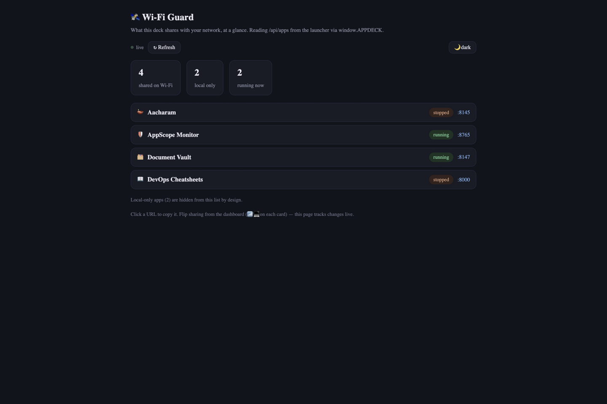

# 🛰️ Wi-Fi Guard

**What this deck shares with your Wi-Fi, at a glance — and what it deliberately keeps
local-only.**

One tiny page, live: it reads the launcher's app list every 5 seconds and splits your
apps into *shared on Wi-Fi* (reachable from other devices) vs *local-only* (hidden from
the network by design). Flip sharing from the dashboard and this page updates itself,
with a toast for every change.



*(Screenshot: fictional mock data — 4 shared, 2 local-only, 2 running.)*

---

## What you get

- **🛰️ The two buckets that matter** — shared-on-Wi-Fi vs local-only, counted up top;
  local-only apps are hidden from the list *by design* (that's the point).
- **🟢 Running / stopped badges** — which shared apps are actually up right now.
- **📡 LAN URLs, click-to-copy** — every shared app shows the address your phone/tablet
  would use; click it to copy.
- **🔄 Live tracking** — 5-second auto-poll plus manual **↻ Refresh**; a toast announces
  every change it sees.
- **🌙 Dark/light**, persisted; ~10 KB self-contained, zero dependencies.

*Privacy model: this page only reads the launcher's status — it never scans the network
or touches other devices. What it shows is exactly what the launcher itself exposes.*

---

## Install

### The easy way — with the AppDeck launcher

1. Put this folder in the launcher's `Apps/` directory (or import its zip).
2. Start the launcher and click the **🛰️ Wi-Fi Guard** tile. It talks to the launcher
   automatically.

### Standalone

```sh
cd WifiGuard
python3 -m http.server
# open http://localhost:8000 — shows its error state without the launcher
```

---

## Your first five minutes

1. Open it next to the launcher dashboard — the counters fill in.
2. Flip an app's sharing (📶/💻 on its card in the dashboard) and watch the toast land
   here within five seconds.
3. Click a LAN URL to copy it; open it on your phone.

---

## How it's built (for the curious / the expert)

```
index.html — the entire app (~10 KB): markup, styles, logic inline; polls
             (window.APPDECK?.launcher || location.origin) + /api/apps
```

- Classification is three filters over the launcher's app list: `network && !desktop &&
  url` → shared; `!network` → local-only; `running` → live badge.
- Theme persisted in `localStorage` (`wifiguard-theme`); everything else is stateless.

## Verify

```sh
python3 -m http.server   # error state without the launcher; with it: live buckets
```
