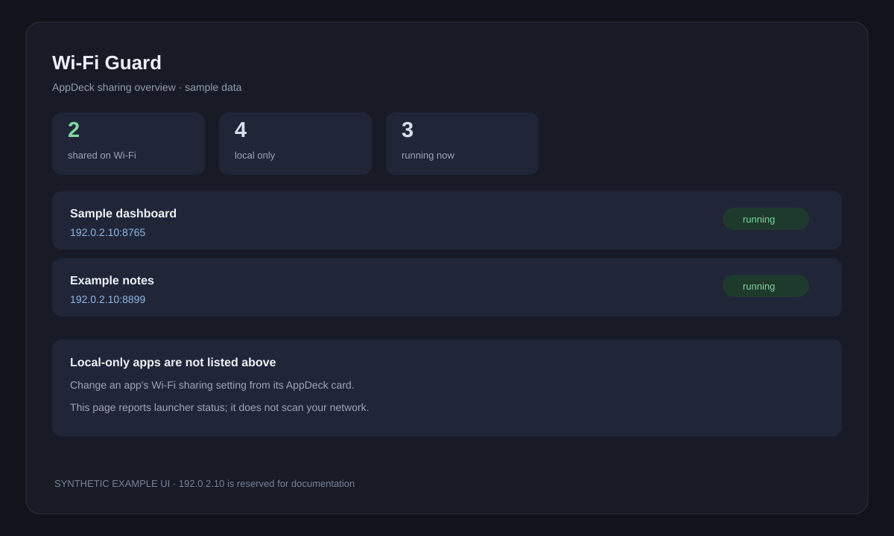

# Wi-Fi Guard

Wi-Fi Guard shows which running AppDeck apps are available to other devices
on your local Wi-Fi, and which remain local-only. It reads the AppDeck
launcher status; it does not scan your network.

*Privacy-safe UI preview: sample app names and the reserved documentation
address `192.0.2.10`; no real network details are shown.*

## Run with AppDeck

Wi-Fi Guard depends on AppDeck's local app-status API, so run it from the
launcher:

1. Start AppDeck from its folder with `go run .`.
2. Start **Wi-Fi Guard** and choose **Open**.
3. Start other apps to see their current status in the list.

The page refreshes its information when it opens. To change an app's sharing
setting, return to the AppDeck dashboard and use that app card's Wi-Fi
sharing control. Wi-Fi Guard only reports the status AppDeck provides.

## Local access and privacy

The list can show LAN URLs and app names. Treat it as local network
information: do not share screenshots or copied URLs without checking them.
Other devices can open an app only when the app is running and AppDeck has
sharing enabled for it. Keep sharing disabled when you only need access from
this computer, and do not expose the launcher to the public internet.
