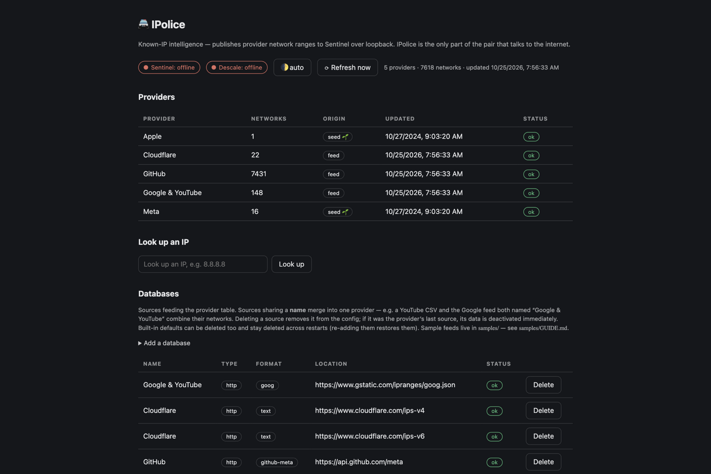
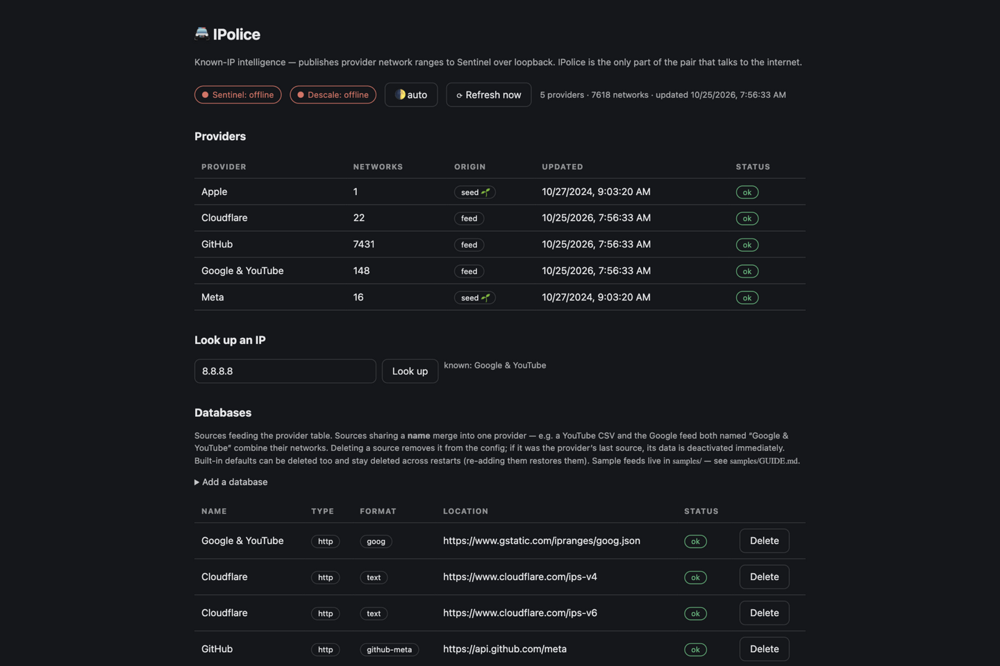

# 🚔 IPolice

**Known-IP intelligence for your machine — fetches provider network ranges (Google,
Cloudflare, GitHub, Apple, Meta…) and publishes them to Sentinel over loopback.**

Part of a security pair: **Sentinel** watches your network but never talks to the internet;
**IPolice is the only half that does.** It downloads and refreshes the published IP ranges
of big providers, merges them into one local database, answers "whose network is this IP?"
instantly, and serves the data to Sentinel (and AppScope Monitor's country blocking) on
localhost.

| | |
|---|---|
|  |  |

---

## What you get

- **📡 Provider ranges as data** — Google & YouTube, Cloudflare, GitHub, Apple, Meta and
  more: each a named *source* (http feed, git repo, local file, or seed) refreshed on a
  schedule (default 24 h) or on demand with **⟳ Refresh now**.
- **🔎 Instant IP lookup** — paste `8.8.8.8`, learn "Google & YouTube"; works across every
  merged database (~7,600 networks out of the box).
- **🗂️ Databases panel** — add/rename/delete sources; same-named sources merge into one
  provider; deletions persist across restarts; sample feeds live in `samples/` with their
  own guide.
- **🤝 Loopback wiring** — publishes to **Sentinel** (status shown live) and hands ranges
  to **AppScope Monitor** for country/blocklist enforcement; optionally scans installed
  apps via **Descale**. No port ever faces the internet.
- **🌱 Seeds included** — starts working offline with seed data; feeds upgrade it.

---

## Install

### The easy way — with the AppDeck launcher

1. Put this folder in the launcher's `Apps/` directory (or import its zip).
2. Start the launcher — it builds IPolice on first start — and click the **🚔 IPolice**
   tile. Pair it with **Sentinel** (same deck) for the full picture.

### Build it yourself

Requires [Go](https://go.dev/dl/):

```sh
cd IPolice
go build -o ipolice ./cmd/ipolice
./ipolice            # serves on http://127.0.0.1:8770
```

---

## Your first five minutes

1. Open the dashboard — the provider table shows each database, its origin (feed/git/seed)
   and freshness.
2. Type `8.8.8.8` into **Look up an IP** — provider match, instantly.
3. Press **⟳ Refresh now** — feeds re-download and the table updates.
4. Scroll to **Databases**: delete a source you don't care about, or add your own (a URL,
   a git repo, or a local CIDR file).
5. Start **Sentinel** and reload — its status chip flips to *online*, and Sentinel's
   alerts can now name the provider behind every connection.

---

## How it's built (for the curious / the expert)

```
cmd/ipolice/
├─ main.go     — flags (host/port/data dir/refresh hours/peer URLs), startup wiring
├─ server.go   — HTTP routes, loopback host guard
├─ sources.go  — source types: http / git / file / seed; fetch + normalize
├─ intel.go    — range store, merge, longest-prefix lookup
├─ store.go    — persistence in the data dir (APPDECK_DATA)
├─ wired.go    — Sentinel publishing + Descale + launcher peer discovery
├─ catalog.go  — built-in default sources
└─ web/        — embedded dashboard UI
```

- **Fetch-normalize-serve** — every source type funnels through one normalizer (JSON,
  plain-text CIDR lists, git-synced files), so lookups are uniform.
- **Architecture rule** — IPolice talks to the internet; Sentinel never does; the two
  speak only over loopback. Compromising the watcher gains an attacker nothing external.
- Loopback-only host guard on every route; the data directory is portable JSON.

## Verify

```sh
go build ./... && go vet ./...
go test ./cmd/ipolice/
./ipolice   # then open http://127.0.0.1:8770
```
