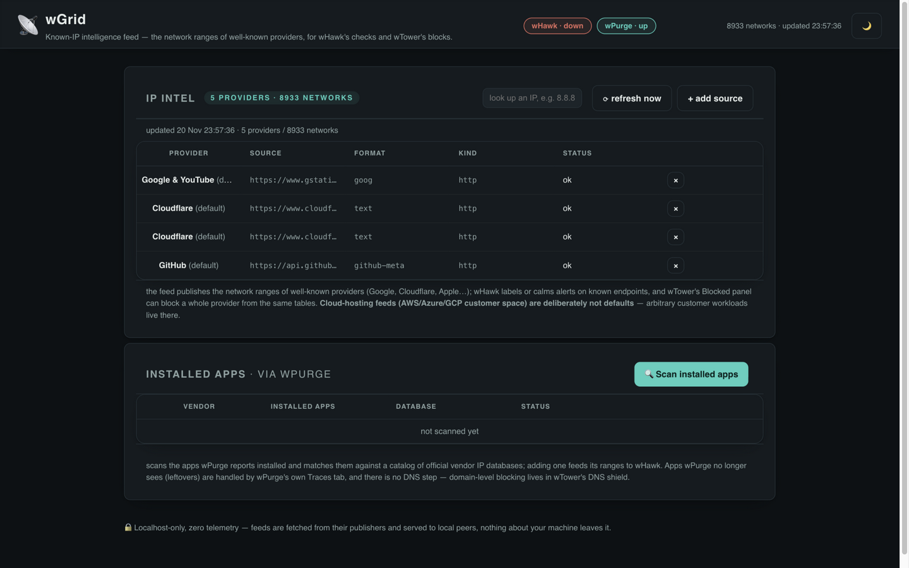

# 🚔 wGrid

**The known-IP intel feed for the deck — the published network ranges of
well-known providers, served over loopback to wHawk and wTower.**

wGrid fetches each provider's official IP list (Google & YouTube, Cloudflare,
Apple, GitHub, Meta…), merges them with bundled seed snapshots for providers
without a stable public source, and publishes the result as CIDR tables:

- **wHawk** consults the feed so its alerts can label or calm findings on
  known provider endpoints.
- **wTower**'s Blocked panel uses the same tables to block an entire provider
  (its 🌐 country rules pull their CIDR data from here automatically).

| | |
|---|---|
|  | |

*(Screenshot: the feed serving its default providers — public network-range
data only.)*

---

## What you get

- **📡 IP intel** — per-provider CIDR tables, merged from live sources and
  bundled seeds; the header shows the live count (`5 PROVIDERS · 8933
  NETWORKS`) and the last update time.
- **🔎 IP lookup** — type any address and see which provider (if any) owns
  its network.
- **📰 Sources you control** — each row shows the source URL, format
  (`goog`, `text`, `github-meta`, `git`…) and its status; **refresh now**
  refetches everything, **＋ add source** takes another provider URL or a
  FireHOL-style git repo, and a ✕ removes it. Sources are data, not code —
  `sources.json` in the feed folder, editable without a rebuild.
- **🧩 Installed apps (via wPurge)** — scans the apps wPurge reports
  installed and matches them against a small catalog of official vendor IP
  databases (Google, Microsoft, GitHub, Telegram, Meta); adding one feeds its
  ranges to wHawk. Apps wPurge no longer sees (leftovers) belong to wPurge's
  own Traces tab, and there is no DNS step — domain-level blocking lives in
  wTower's DNS shield.
- **🤝 Peer pills** — live status of the two peers it pairs with (wHawk,
  wPurge), discovered through the AppDeck launcher's app registry with a
  fallback to configured URLs.
- **🔒 Loopback-only, zero telemetry** — feeds are fetched from their
  publishers and served to local peers; nothing about your machine leaves it.

---

## Install

### The easy way — with the AppDeck launcher

1. Put this folder in the launcher's `Apps/` directory (or import its zip).
2. Start the launcher — it builds wGrid on first start — and click the
   **🚔 wGrid** tile. Run it beside **wHawk** and **wTower** for the full
   picture; the peers are found automatically through the launcher's app
   registry.

### Build it yourself

Requires [Go](https://go.dev/dl/):

```sh
cd wGrid
go build -o wgrid ./cmd/wgrid
./wgrid 8768
# open http://127.0.0.1:8768
```

The server accepts a bare port positionally (as AppDeck passes one), or uses
`APPDECK_PORT`/`PORT` from the environment; without any of them it defaults
to `8768`. `WGRID_ROOT` points at the app folder when you run the binary from
elsewhere.

---

## Your first five minutes

1. Open the dashboard — the provider table fills with the default sources
   and their statuses.
2. Type a known IP (e.g. `8.8.8.8`) into **look up an IP** and see the
   provider match.
3. Press **↻ refresh now** to pull fresh ranges from every live source.
4. **＋ add source** to follow another provider's published list, or ✕ a row
   to stop tracking it.
5. Open **wTower**'s Blocked panel and block one of these providers — the
   CIDR data comes straight from this feed.

---

## How it's built (for the curious / the expert)

```
cmd/wgrid/
├─ main.go       — loopback server, port resolution, peer wiring
├─ intelfeed.go  — fetch/merge of provider sources + bundled seed snapshots
├─ sources.go    — source list plumbing (sources.json, add/delete, formats)
├─ api.go        — the JSON API (status, networks, intel lookup, sources, wired)
├─ catalog.go    — installed-app → vendor IP database matching rules
├─ wpurge.go     — wPurge client for the installed-apps inventory
├─ wired.go      — peer discovery via the launcher registry (+ fixed-URL fallback)
├─ git.go        — FireHOL-style git sources (shallow clone, pull, parse)
├─ migrate.go    — seeds the feed folder on first run, migrates old state
└─ hostguard.go  — DNS-rebinding / cross-site guard (house style)
```

- **State lives in the feed folder** (`<APPDECK_DATA>/feed` under the
  launcher; `./data` on a manual run): `sources.json` (the source list),
  `cache.json` (last-good ranges per provider) and `repos/` (git sources).
  Delete the folder and the app rebuilds it from seeds.
- **Seeds keep the feed useful offline**: a bundled snapshot serves while a
  live source is being fetched or failing — the status column says which
  origin a provider's data came from (`fetch` vs `seed`).
- **No DNS, no proxying** — wGrid only publishes IP ranges; name-layer
  blocking is wTower's DNS shield, and wGrid never sees your traffic.

## Verify

```sh
go build ./... && go vet ./...
./wgrid 8768   # open the dashboard, look up 8.8.8.8, refresh now
```
