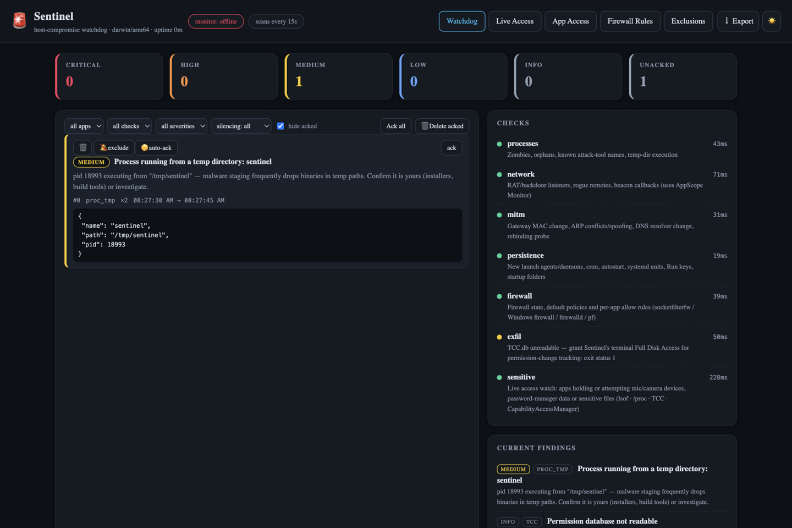
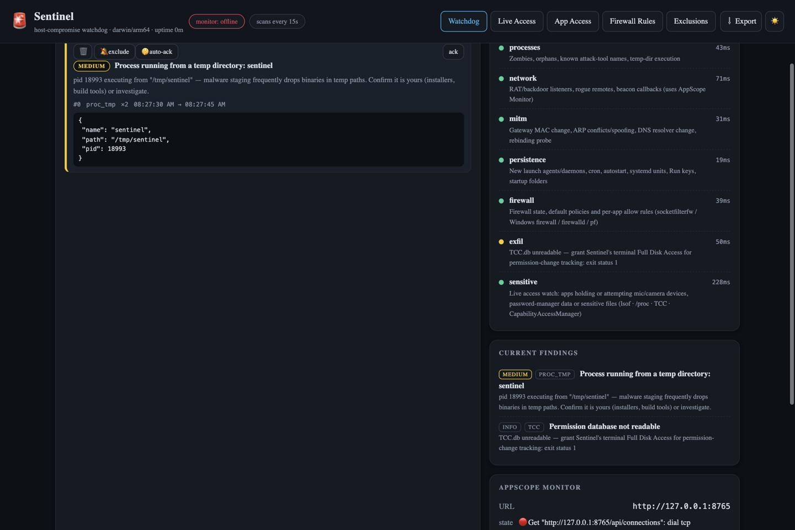

# 🚨 wHawk

**A host-compromise watchdog for your machine — RATs, MITM, rogue IPs, zombie processes,
keyloggers, exfiltration: checked every 15 seconds, alerted the moment they appear.**

wHawk never talks to the internet. It watches *your own machine* — processes, network
listeners, ARP/DNS state, persistence locations, the firewall — and enriches network
findings with provider intelligence from **wGrid** (its loopback-only partner) and
connection data from **wTower** when that's running. Detection rules, not vibes:
every alert names the check, the evidence, and what to do.

| | |
|---|---|
|  |  |

*(Screenshot: a real catch — the watchdog flagged a binary running from a temp directory,
exactly the way malware stages itself.)*

---

## What you get

- **🧟 Process checks** — zombies, orphans, known attack-tool names, execution from temp
  paths.
- ** RAT/backdoor listeners, rogue remotes, beacon-callback patterns** — enriched with
  wTower's connection stream when available.
- **🕵️ MITM checks** — gateway MAC changes, ARP conflicts/spoofing, DNS resolver changes,
  rebinding probes.
- **⚓ Persistence checks** — new launch agents/daemons, cron, autostart, systemd units,
  Run keys, startup folders.
- **🧱 Firewall checks** — firewall state, default policies, per-app allow rules.
- **🔌 Local ports** — searchable TCP listeners and bound UDP ports, owning process
  when visible, likely service, bind scope and risk guidance. Network-bound
  databases, admin/remote-access services, development servers and unattributed
  owners are highlighted; loopback-only ports do not create port alerts. The
  table also includes per-app active connection endpoints from wTower when it is
  running, with public/private/loopback address classification.
- **🚨 A working alert pipeline** — severities CRITICAL→INFO, ack/exclude/auto-ack per
  finding, silencing windows, notifications, export; scans every 15 s.
- **⛔ The wTower bridge** — alerts that name a public remote IP carry a **⛔ block**
  button: one click queues a firewall block for that IP in the running wTower
  (over loopback; the rule lands behind wTower's own validation and Grant flow).
  wHawk finds it, you approve it, wTower cuts it.
- **🔒 Architecture honesty** — wHawk makes **zero external requests**; the *only*
  internet-facing half of the pair is wGrid (see its README), and they talk over
  loopback.

---

## Install

### The easy way — with the AppDeck launcher

1. Put this folder in the launcher's `Apps/` directory (or import its zip).
2. Start the launcher — it builds wHawk on first start — and click the **🚨 wHawk**
   tile. Run it beside **wTower** and **wGrid** for the full picture; the peers are
   found automatically through the launcher's app registry.

### Build it yourself

Requires [Go](https://go.dev/dl/):

```sh
go build -o whawk ./cmd/whawk
./whawk                         # or: ./whawk -once   (one scan, print, exit)
```

---

## Your first five minutes

1. Open the dashboard — severity counts up top; unacked findings below with
   evidence JSON.
2. Read an alert fully: check name, the plain-language explanation, the evidence payload.
3. Real alert → investigate; known-benign → **ack** once, **exclude** the rule, or
   **auto-ack** its future occurrences.
4. Scan the **CHECKS** list — each shows what it looks for and how long it took.
5. Try **⇨ Export** to keep an incident record.
6. Open **Ports** to review TCP listeners and UDP endpoints. Filter by protocol,
   bind scope, risk, connection state, app, or remote endpoint; choose a
   table heading to sort ascending, then click it again to reverse the order.
   **Scan now** requests a normal wHawk scan.

The port inventory is collected locally and offline; it does not depend on wTower
or wGrid. “Network interface” and “All interfaces” describe the socket's bind
address only and do not guarantee reachability through the OS firewall, router,
or other network controls. A flagged service is a prompt to verify its purpose,
authentication, and network exposure—not proof of compromise.

### Port-scan platform notes

- **Linux:** reads `/proc/net` socket tables and maps socket inodes to process
  file descriptors. Systems using `hidepid` or other `/proc` restrictions may
  show ports without process names or mark a scan partial.
- **macOS:** uses the built-in `lsof` command for TCP listeners and UDP sockets. Full command names are
requested (instead of lsof's default shortened display), and process
enumeration is a fallback. It can only attribute processes visible to the
wHawk user; permissions and socket-table access affect coverage.
- **Windows:** uses PowerShell's `Get-NetTCPConnection` and `Get-NetUDPEndpoint`
  cmdlets and process enumeration. If PowerShell or either networking cmdlet is
  unavailable or denied, wHawk marks the scan incomplete instead of presenting
  an empty inventory as complete.

The scan inventories TCP listeners and bound UDP endpoints, not established
outbound connections. The optional active-connection rows and their app names
come from wTower's local connection feed; UDP sockets may also include a remote
endpoint when the operating system reports one. No process-killing or firewall
changes are offered from the Ports view.

---

## How it's built (for the curious / the expert)

```
cmd/whawk/
├─ engine.go / beacon.go / exfil.go / integ.go — the detection engine: process, network,
│   beacon-periodicity, exfil-heuristics and integrity checks
├─ firewall.go / intel.go / peers.go — firewall state; provider intelligence via loopback
│   wGrid; launcher-registry peer discovery + one-time state migration
├─ ports.go — local TCP/UDP inventory, per-OS discovery and port-risk guidance
├─ alert.go / exclusions.go — severity pipeline, ack/exclude/auto-ack persistence
└─ main.go — loopback server + UI
Scripts/tcc.sh — macOS TCC helper
```

- **No-agent-hub design**: the watchdog reads only local state (+ the loopback feeds);
  there is no code path to an external network destination.
- `-once` mode makes the whole engine scriptable (cron it, pipe to your alerting).

## Verify

```sh
go build ./... && go vet ./... && go test ./...
./whawk -once
```
