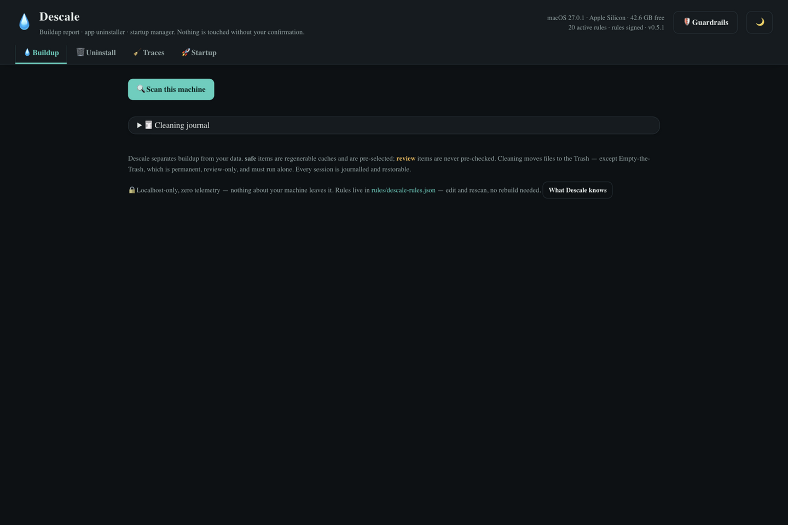
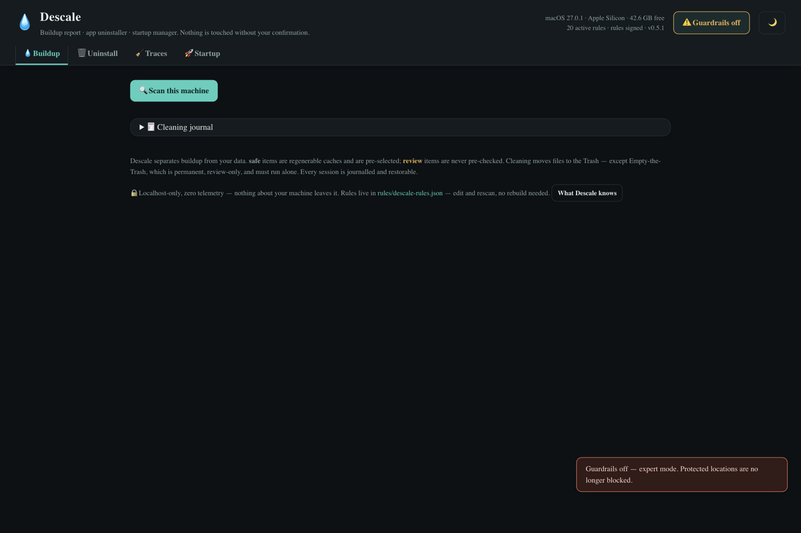
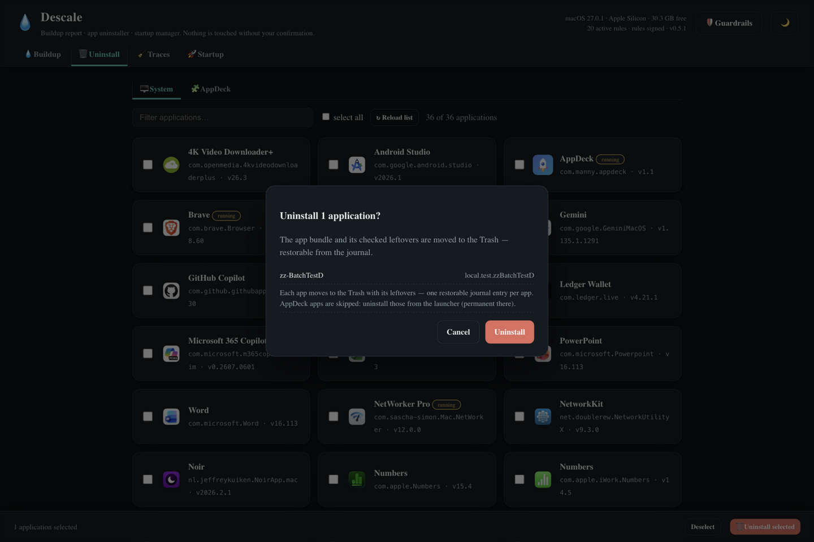

# 💧 Descale

**The kettle-cleaner for your computer: buildup report, app uninstaller and startup
manager — and nothing is ever touched without your confirmation.**

Caches, logs, crash reports, leftover app traces, AI model caches, things that sneak into
login items… Descale finds the scale, shows you exactly what it is, and moves it to the
Trash (never straight to deletion). Every session is journalled — after every rule — and
restorable.

| | |
|---|---|
|  |  |
|  | |

---

## What you get

- **🗺️ wGauge companion** — the disk space explorer (sunburst, treemap,
  bars) is its own app again; its 🧹 Hand to Clean opens wPurge with the
  scanned path and points you at the matching rule below.
- **💧 Buildup report** — regenerable caches (browser, app, cargo, brew…), logs, crash
  reports, orphaned downloads — grouped, sized, and separated from *your data*. The safe
  tier splits by **how it comes back**: ⚙️ **Rebuilds locally** (build output, indexes —
  the next build is slower) and ⬇️ **Re-downloads** (package/binary caches — fetched
  again when your tools need them), each selectable as a group from the stats bar.
- **🤖 AI model caches** — Ollama, Hugging Face, LM Studio, PyTorch Hub, Whisper,
  llama.cpp. Review-tier: models are huge re-downloads, so they are never pre-selected
  (single models are better removed with `ollama rm`).
- **🛠️ Dev-tool catalog** — Playwright/Puppeteer/Cypress/Electron browser builds,
  JetBrains per-version caches, Yarn/Bun/Deno/pnpm, Go module cache, NuGet, ccache,
  Composer, Poetry, uv, CocoaPods…
- **🗺️ macOS · Windows · Linux** — per-OS rule files, a freedesktop Trash with
  `.trashinfo` metadata on Linux (file managers can restore), XDG autostart in the
  startup manager, Flatpak/Snap trace roots.
- **⚙️ Settings** — a Downloads-age cutoff (1/5/15/30/custom days) for the
  installer rule; per-rule switches for every extra/imported rule (unchecked = the
  built-in default applies); rules **export/import** — hand a JSON to another machine,
  tune it, bring it back.
- **🗑️ App uninstaller — one app or a whole batch** — pick an app (or check
  several and press *Uninstall selected*): Descale collects the binary plus its scattered
  traces (preferences, appdata, caches) for one confirmed Trash move. Batch
  uninstalls write one restorable journal entry per app; running apps and
  AppDeck apps (their removal is permanent) are skipped with a reason —
  uninstall AppDeck apps from the launcher's own batch select.
- **🧹 Traces** — leftovers from apps already gone.
- **🚀 Startup manager** — see and toggle what launches at login.
- **🧾 Cleaning journal** — journalled after *every rule*, not just at the end: a
  crash mid-clean still leaves every completed rule restorable; interrupted sessions
  say so.
- **🛡️ Guardrails, by design**:
  - *safe* items (regenerable caches) are pre-selected; *review* items are never
    pre-checked — you opt in, one by one.
  - Cleaning moves files **to the Trash**; "Empty the Trash" is the only permanent action,
    review-only, and must run alone.
  - Rules are **signed** — the engine refuses rule files that don't match their signature.
  - Localhost-only, zero telemetry: nothing about your machine leaves it.
  - **Duplicates are a loud error** — inside a rules file, across the built-in pair;
    an imported rule *replaces* a same-id built-in (that's the tuning mechanism).

---

## Install

### The easy way — with the AppDeck launcher

1. Put this folder in the launcher's `Apps/` directory (or import its zip).
2. Start the launcher — it builds Descale on first start — and click the **💧 Descale** tile.

### Build it yourself

Requires [Go](https://go.dev/dl/):

```sh
cd Descale
go build -o wpurge ./cmd/wpurge
./wpurge 8212
# open http://127.0.0.1:8212
```

(`start.sh` / `start.bat` at the root do the same.)

---

## Your first five minutes

1. Read the landing page — the guardrails summary tells you the rules of the game before
   anything happens. The server starts **read-only** until you confirm a clean.
2. Press **🔍 Scan this machine** — you'll get a buildup report grouped by category with
   sizes. Click any card for the details: what it is, where the facts come from, and
   how it comes back.
3. Review the pre-checked *safe* items (caches that regenerate); anything marked *review*
   starts unchecked — read before ticking.
4. **Clean** — items go to the Trash; the toast offers **Undo**. Changed your mind later?
   The **🧾 journal** shows the session and restores it.
5. Visit **⚙️ Settings** for the Downloads age, the extra-rule switches and rule
   import/export, **🚀 Startup** to trim what auto-launches, and **🗑️ Uninstall** the
   apps you thought you'd removed.

---

## How it's built (for the curious / the expert)

```
cmd/wpurge/           — Go server: scan engine, Trash-based removal, journal, signature check
rules/wpurge-<os>-rules.json (+ .sig)      — the built-in rules for your OS: DATA, not code —
rules/wpurge-<os>-extra-rules.json (+ .sig)  the extra catalog (AI, dev tools, Docker);
                                             edit the JSON and rescan, no rebuild needed;
                                             the .sig pins each file so a swapped file is
                                             rejected
index.html, js/app.js, css/app.css — dashboard UI served by the binary
start.sh / start.bat  — manual launch helpers
```

- **Rules as data, per OS** — the engine loads only the pair for the running OS; on top
  of it sits the optional imported ruleset (`~/.wpurge/rules-user.json`, written by
  ⚙️ Settings → Import). A rule tagged `"minAgeSetting": "downloads"` follows the
  operator's Downloads-age setting instead of its own `minAgeDays`.
- **Whole-cache Trash moves** — the Go module cache moves as one journalled folder,
  avoiding per-file permission failures on Go's read-only module directories.
- **Confirm-first architecture** — the server boots read-only; every mutation requires an
  explicit confirmation flow, and everything lands in the Trash except the single,
  review-only "Empty the Trash".
- Runs loopback-only; the UI is the only client.

## Verify

```sh
gofmt -l . ; go build ./... ; go vet ./... ; go test ./...
node --check js/app.js
```

Live smoke: run the binary on a test port with `WPURGE_HOME=$(mktemp -d)` — see AGENTS.md.
